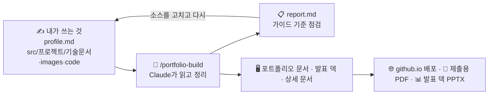

# 포트폴리오 자동 작성 템플릿 (Claude Code)

내가 쓴 **기술 문서 · 스크린샷 · 소스코드**를 Claude가 읽고 조합해서,
「[유니티 개발자 취업·기술 문서 작성 가이드 v2](https://koohoo-dev.github.io/edu-lecture-portfolio-guide/)」 기준에 맞는
**포트폴리오 웹페이지 세 가지**(포트폴리오 문서 · 발표 덱 · 상세 기술문서)와 **점검 리포트**를 만들어 줍니다.
결과물은 설치·빌드 과정 없이 GitHub Pages로 바로 배포되고, 제출용 PDF로도 저장할 수 있습니다. 발표 덱은 PowerPoint 파일(PPTX)로 저장해 직접 고쳐 쓸 수도 있습니다.

**예시 보기** → https://krkoohoo.github.io/portfolio-test/
(이 레포에 들어 있는 샘플 프로필과 선배 수강생 작품 3편으로 만든 페이지입니다.)



> **이 템플릿이 대신 해 주지 않는 것**: 기술 문서를 *써 주는 것*. Claude는 여러분이 쓴 내용을 **정리·점검**할 뿐,
> 없는 사실을 지어내거나 문서를 고쳐 쓰지 않습니다. 기술 문서의 목적은 *"내 코드를 설명할 줄 안다"* 를 보여주는 것이니까요.

## 목차

- [무엇이 만들어지나요](#무엇이-만들어지나요) · [빠른 시작](#빠른-시작) · [준비물](#준비물)
- 따라 하기: [1. 내 레포 만들기](#1단계-내-레포-만들기) → [2. 기술 문서와 소스 넣기](#2단계-기술-문서와-소스-넣기) → [3. profile.md 채우기](#3단계-profilemd-채우기) → [4. 포트폴리오 만들기](#4단계-포트폴리오-만들기) → [5. 미리보기](#5단계-미리보기) → [6. 배포하기](#6단계-배포하기) → [7. PDF로 제출하기](#7단계-pdf로-제출하기)
- 기능 자세히: [명령 모음](#명령-모음) · [세 페이지 자세히](#세-페이지-자세히) · [발표 덱 장면 고치기](#발표-덱-장면-고치기) · [발표 덱을 PPTX로 저장하기](#발표-덱을-pptx로-저장하기) · [디자인 바꾸기](#디자인-바꾸기) · [템플릿 업데이트 받기](#템플릿-업데이트-받기)
- 참고: [문제 해결](#문제-해결) · [폴더 구조](#폴더-구조) · [지키는 원칙](#지키는-원칙)

---

## 무엇이 만들어지나요

| 결과 | 주소 | 무엇인가요 | 어디에 쓰나요 |
|---|---|---|---|
| **포트폴리오 문서** | `index.html` | 아래로 읽는 한 페이지. 자기소개 → 기술 스택 → 프로젝트마다 소개·기능 소개 → 한눈에 보기 → 연락처 | 지원서에 넣는 링크, **제출용 PDF**(A4) |
| **발표 덱** | `project.html?p=<폴더 이름>` | 기술 문서를 바탕으로 한 16:9 발표 슬라이드. 프로젝트마다 하나 | 면접·발표, 프로젝트별 PDF, PowerPoint에서 고쳐 쓰는 **PPTX** |
| **상세 기술문서** | `doc.html?p=<폴더 이름>` | 기술 문서 전문을 읽기 좋게 보여 주는 긴 문서 | 더 깊이 읽고 싶은 사람에게 |
| **점검 리포트** | `report.md` (내 PC에만) | 가이드 기준으로 기술 문서를 점검한 결과(필수 · 권장 · 참고) | 기술 문서를 고칠 때 |

- 세 페이지는 서로 링크로 이어집니다. 포트폴리오 문서의 기능마다 **[발표 덱에서 보기]** 버튼이 그 기능을 다루는 발표 장면으로 바로 갑니다.
- 기본 모양은 **흰 바탕 + 강조색 한 가지**입니다. 강조색·문구는 [디자인 바꾸기](#디자인-바꾸기)로 바꿀 수 있습니다.
- 휴대폰에서도 볼 수 있습니다(좁은 화면에서는 배치가 한 단으로 바뀌고, 발표 덱은 밀어서 넘깁니다).

## 빠른 시작

처음 한 번은 아래 순서대로 하면 됩니다. 단계마다 자세한 설명은 링크를 보세요.

1. 이 레포를 **Fork**해서 내 PC에 clone합니다. → [1단계](#1단계-내-레포-만들기)
   - clone하자마자 [미리보기](#5단계-미리보기)를 열면 샘플로 만든 결과를 바로 볼 수 있습니다. 어떤 모양이 나오는지 먼저 보세요.
2. `src/`의 샘플 프로젝트 4개를 지우고, 내 프로젝트 폴더(예: `src/1-my-game/`)에 `기술문서.md`와 `images/`를 넣습니다. → [2단계](#2단계-기술-문서와-소스-넣기)
   - 기술 문서가 아직 없다면 `/portfolio-intake <내 GitHub 레포 주소>`로 재료부터 뽑고, 쓰는 중에는 `/portfolio-check`로 점검받습니다.
3. `profile.md`의 예시 값(홍길동 등)을 내 정보로 바꿉니다. → [3단계](#3단계-profilemd-채우기)
4. 레포 폴더에서 Claude Code를 열고 `/portfolio-build`를 입력합니다. → [4단계](#4단계-포트폴리오-만들기)
5. `report.md`를 읽고 **원본(`src/`·`profile.md`)을 고친 뒤** 다시 `/portfolio-build` — 만족할 때까지 되풀이합니다.
6. 미리보기로 확인하고 commit · push → GitHub **Settings → Pages**에서 `main` / `(root)`로 배포합니다. → [5단계](#5단계-미리보기) · [6단계](#6단계-배포하기)
7. 배포된 주소에서 **[PDF로 저장]** 버튼으로 제출용 PDF를 만듭니다. → [7단계](#7단계-pdf로-제출하기)

## 준비물

| 준비물 | 비고 |
|---|---|
| GitHub 계정 | 무료 플랜은 **공개(Public) 레포**에서만 Pages가 동작합니다 |
| Git | clone·commit·push에 씁니다. Windows는 [Git for Windows](https://git-scm.com/download/win). `/portfolio-intake`·`/portfolio-update`도 Git을 씁니다 |
| [Claude Code](https://claude.com/claude-code) | 터미널(CLI) · 데스크톱 앱 · IDE 확장 어느 것이든. **이 레포 폴더를 열고** 써야 `/portfolio-…` 명령이 보입니다 |
| [Python](https://www.python.org/downloads/) 3.8 이상 (권장) | 미리보기 서버, 빌드 중 검사에 씁니다. 발표 덱 장면 고치기(`/portfolio-edit`)에는 **꼭 필요**합니다. 설치 화면에서 **Add python.exe to PATH**를 체크하세요. 미리보기만이라면 JetBrains IDE의 내장 서버로 대신해도 됩니다 |
| Windows PC의 Chrome 또는 Edge | 제출용 PDF 저장이 보장되는 환경입니다 |

---

## 1단계. 내 레포 만들기

아래 두 방법 중 하나를 고르세요. 어느 쪽이든 내 레포는 **공개(Public)여야** 무료 플랜에서 Pages가 동작합니다.

**방법 A. Fork (추천)**

1. 이 레포 오른쪽 위 **Fork → Create fork**를 누릅니다. "Copy the `main` branch only"는 체크된 그대로 둡니다.
2. 레포 이름은 바꿔도 됩니다(예: `portfolio`). 영문 소문자·숫자·하이픈을 권합니다.
   레포 이름을 `<아이디>.github.io`로 만들면 배포 주소가 `https://<아이디>.github.io/`로 짧아집니다.
3. 내 레포 화면의 **Code → HTTPS 주소**로 내 PC에 clone합니다.

**방법 B. 새 레포를 만들고 파일 복사**

1. GitHub에서 **New repository**로 빈 공개 레포를 만들고 내 PC에 clone합니다.
2. 이 레포에서 **Code → Download ZIP**으로 받아 압축을 풉니다.
3. 압축을 푼 폴더 안의 내용(숨김 파일 `.claude/`, `.gitignore`, `.nojekyll` 포함)을 **모두** 내 레포 폴더로 복사한 뒤 commit · push합니다.
   - 숨김 파일이 빠지면 Claude 명령(`/portfolio-build` 등)과 Pages 동작이 깨집니다. 탐색기에서 **보기 → 숨긴 항목**을 켜고 복사하세요.

> 유지관리자가 이 레포를 Template repository로 설정해 두었다면 **Use this template → Create a new repository**도 쓸 수 있습니다(방법 A와 비슷하지만 Sync fork는 없습니다).

나중에 템플릿이 업데이트되면 어느 방법으로 만든 레포든 `/portfolio-update`로 받습니다 → [템플릿 업데이트 받기](#템플릿-업데이트-받기)

## 2단계. 기술 문서와 소스 넣기

```
src/
└── 1-my-game/              ← 프로젝트 하나 = 폴더 하나 (앞 번호로 순서 정렬)
    ├── 기술문서.md          ← 기술 문서 (폴더 바로 아래 .md 하나. README.md여도 됩니다)
    ├── images/             ← 스크린샷·GIF (4~6장 권장)
    ├── code/               ← (선택) 핵심 소스코드 .cs — 문서의 코드와 실제 코드가 맞는지 점검에 씀
    └── deck-edits.json     ← (자동) /portfolio-edit로 발표 덱 장면을 고치면 생김. 지우지 말고 함께 커밋
```

- **폴더 이름이 페이지 주소가 됩니다**(`project.html?p=1-my-game`). 영문 소문자·숫자·하이픈을 권하고, 링크를 공유한 뒤에는 바꾸지 마세요.
- 이름이 `_`로 시작하는 폴더(예: `src/_draft/`)는 무시됩니다. 초안 보관용으로 쓰세요.

### 기술 문서 쓰는 법 (요약)

기준은 [format/02-tech-document.md](format/02-tech-document.md)의 **5단 구조**입니다. 가장 짧은 견본은 [src/00-example-crafting/기술문서.md](src/00-example-crafting/기술문서.md)입니다.

| 단계 | 무엇을 쓰나요 |
|---|---|
| 1. 개요 | 무엇을(What) · 왜(Why) 만들었나. 장르·기간·인원·환경·링크를 담은 개요 표 |
| 2. 시스템 구조 | 어떻게 구성했나. 다이어그램 1개 이상 |
| 3. 핵심 기능 | 어떻게 동작하나. 코드와 설명 |
| 4. 고민과 선택 | 왜 이 방법인가. 다른 방법과 비교 |
| 5. 결과 및 배운 점 | 결과·트러블슈팅·회고 |

문서 유형은 **A. 단일 기능** / **B. 다기능**(기능별로 구조·기능·선택 반복) / **C. 팀 프로젝트**(팀·역할과 담당 파트 중심) 셋 중 하나로 점검합니다.

페이지가 잘 나오게 하는 작성 요령:

- **한 줄 소개**: 문서 제목 바로 아래에 `> 한 줄 소개` 인용문을 두면 그대로 실립니다(없으면 Claude가 What을 줄여 만들고 "확인해 주세요"에 올림).
- **개요 표**: 장르 · 개발 기간 · 개발 인원 · 개발 환경 · 링크를 표로 두면 프로젝트 소개의 정보 칸이 됩니다.
- **대표 이미지**: ``처럼 대체 글을 "대표 이미지"로 쓰면 그 그림이 대표 이미지가 됩니다(없으면 문서의 첫 그림).
- **이미지 경로**: ``처럼 **상대경로**로, 파일 이름의 **대소문자까지 정확히** 씁니다(GitHub Pages는 `Cover.png`와 `cover.png`를 다르게 봅니다).
- **링크**: GitHub·시연 영상 링크는 실제 주소로 씁니다(`#`이나 빈 링크는 리포트에 나옵니다). 영상은 YouTube 등에 올리고 짧은 주소(`youtu.be/…`)를 쓰면 PDF에서도 읽기 편합니다.
- **다이어그램**: ` ```mermaid ` 코드 블록으로 쓰면 세 페이지가 그대로 그려 줍니다(그림 파일로 바꿀 필요 없음). 노드는 10개 이하를 권하고, 위아래로 너무 길면 발표 덱에서 글자가 작아집니다.
- **코드**: 20줄을 넘는 코드 블록은 발표 덱에서 두 장면으로 나뉩니다(상세 문서에는 전체가 그대로). 발표에서 보일 핵심이 어디인지 생각해 두세요.
- **팀 프로젝트**: "내 역할 / 담당"을 꼭 적으세요(없으면 리포트 **필수**).
- 발표 덱의 장은 문서의 `##` 제목 순서로 만들어집니다. 제목을 정리해 두면 발표 덱 목차도 깔끔해집니다.

### 기술 문서가 아직 없다면 — `/portfolio-intake`

내 GitHub 레포에서 기술 문서의 **재료**부터 뽑을 수 있습니다.

```text
/portfolio-intake https://github.com/내아이디/내레포
```

- Claude가 레포를 잠깐 받아 **코드와 커밋 기록으로 확인되는 사실**(Unity 버전·패키지·클래스 구조·커밋 기간·버그 수정 후보)과
  **여러분만 답할 수 있는 질문**(왜 이렇게 만들었는지, 무엇을 고민했는지)을 정리합니다. 처음에 폴더 이름 제안과 몇 가지 질문(개인/팀, 외부에서 가져온 코드, 시연 영상)을 한 번에 묻습니다.
- 만들어지는 것

  | 파일 | 내용 |
  |---|---|
  | `src/<번호-이름>/code/` | 핵심 `.cs` 사본(원본 그대로 복사) |
  | `src/<번호-이름>/_intake/재료집.md` | ✅ 사실(근거 `파일:줄`·커밋) · ❓ 질문 · ⚠ 추정, 클래스 다이어그램 초안 |
  | `src/<번호-이름>/_intake/촬영목록.md` | 찍어야 할 화면·GIF 목록 |
  | `report-intake.md` (레포 맨 위) | 비밀값 의심 위치, 뺀 파일과 이유, 확인할 것 |

- **기술 문서는 만들어 주지 않습니다.** 재료집의 질문에 답하며 `기술문서.md`를 직접 쓰고, 촬영목록대로 찍은 그림을 `images/`에 넣으세요. "질문에 대신 답해 줘"는 거절합니다.
- `_intake/`와 `report-intake.md`는 git에 올라가지 않습니다(내 PC에만).
- 비밀값(API 키 등)이 의심되는 파일은 복사하지 않고 `report-intake.md`에 위치만 알려 줍니다. 팀 프로젝트는 내가 커밋한 코드 위주로 고르고, 팀원 코드가 섞인 파일은 올려도 되는지 먼저 묻습니다.
- 비공개 레포는 "로그인해서 받아 줘"라고 하면 뜨는 브라우저 창에서 직접 로그인하거나, 레포를 직접 clone·ZIP으로 받아 **그 폴더 경로**를 주면 됩니다.
- 그 밖의 옵션: 폴더 이름 직접 지정(`/portfolio-intake <주소> 3-my-rpg`), 브랜치 지정(`--branch dev`), 다시 뽑기(`--update` — `code/`의 이 명령이 넣은 파일과 `_intake/`만 새로 씀. `기술문서.md`·`images/`는 절대 건드리지 않음).

### 쓰는 중에 점검받기 — `/portfolio-check`

```text
/portfolio-check 1-my-game
```

- 기술 문서를 가이드 기준(5단 구조·포트폴리오 체크리스트·다이어그램)으로 점검해 `report.md`에 피드백만 씁니다. `data/`는 건드리지 않습니다. 폴더 이름을 빼면 모든 프로젝트를 봅니다.
- 항목마다 **어디가 / 무엇이 부족하고 / 왜 중요한지 / 어떤 방향으로**를 알려 주고, 잘한 점도 짚어 줍니다. 고친 문장을 대신 써 주지는 않습니다.
- 빠진 다이어그램은 Claude에게 그대로 부탁할 수 있는 **요청 문장**으로 제안합니다.
- 발표 덱에서 작아지거나 나뉠 곳(노드가 많은 다이어그램, 20줄 넘는 코드)도 미리 **참고**로 알려 줍니다.
- 이미지 경로의 대소문자, 빈 링크, `code/`와 문서 코드가 맞는지도 확인합니다.

### 샘플 프로젝트

`src/`에 들어 있는 **샘플 프로젝트 4개는 참고용**입니다. 내 프로젝트를 넣었다면 **모두 지우세요**.

| 샘플 | 참고할 점 |
|---|---|
| `00-example-crafting/` | 가이드 관통 예제. 가장 짧은 **A형(단일 기능)** + `code/` 폴더 예시 |
| `0-Tidy-Mommy/` | 선배 수강생 작품 — **B형(다기능)**, 고민과 선택 비교 표 |
| `1-action-platformer/` | 선배 수강생 작품 — **B형**, 트러블슈팅·스크린샷 구성 |
| `2-Yggdrasil/` | 선배 수강생 작품 — **C형(팀 프로젝트)**, 내 역할 분리 |

> 선배 수강생 작품은 **작성자의 동의를 받아** 싣습니다. 구조와 서술 방식을 참고하되, 내용을 베끼지 마세요.

탐색기에서 네 폴더를 지운 뒤 `/portfolio-build`를 실행하면 `data/projects/`의 샘플 데이터도 함께 정리됩니다(지우기 전에 목록을 알려 줍니다). 터미널로 지우려면:

```bash
git rm -r -q src/00-example-crafting src/0-Tidy-Mommy src/1-action-platformer src/2-Yggdrasil
```

## 3단계. profile.md 채우기

`profile.md`는 **여러분이 직접** 씁니다. 들어 있는 값(홍길동, `you@example.com` 등)은 예시이니 모두 내 정보로 바꾸세요(예시 그대로면 리포트 **필수**). 비워 둔 항목은 페이지에 나오지 않습니다.

| 항목 | 어디에 쓰이나요 | 메모 |
|---|---|---|
| 이름 · 영문 이름 · 한 줄 정체성 | 포트폴리오 문서 머리 | |
| 이메일 · GitHub · 기타 링크 | 머리 · 연락처 | |
| 자기소개 | 자기소개 절 | 2~3문장. Claude가 고쳐 쓰지 않고 줄바꿈까지 그대로 싣습니다 |
| 기술 스택 메모 (선택) | 기술 스택 절 | 적은 기술마다 Claude가 기술 문서에서 **근거를 찾아** "경험 기반" 문장으로 만듭니다. 근거를 못 찾은 기술은 싣지 않고 리포트로 알립니다. 비우면 문서에서 자동으로 고릅니다 |
| 강조색 | 버튼 · 링크 · 태그 | `#2F6FEB`처럼 색 코드 하나 |
| 프로젝트 순서 | 실리는 프로젝트와 순서 | 비우면 `src/` 폴더 이름 순서. 순서를 정하거나 일부만 싣고 싶을 때만 폴더 이름을 쉼표로(예: `2-my-rpg, 1-my-game`). 대소문자까지 정확히 |
| 구성 방식 | — | `project`(프로젝트 중심) / `stack`(기술 스택 중심). **지금의 포트폴리오 문서에는 아직 반영되지 않습니다** |

> 이 레포는 공개라서 `profile.md`의 내용은 누구나 볼 수 있습니다. 전화번호·주소 같은 개인정보는 넣지 마세요.

## 4단계. 포트폴리오 만들기

레포 폴더에서 Claude Code를 열고 입력합니다. "포트폴리오 만들어 줘"라고 말해도 됩니다.

```text
/portfolio-build
```

프로젝트 하나만 다시 만들 때는 `/portfolio-build 1-my-game`.

**Claude가 하는 일**

1. `src/`의 기술 문서를 끝까지 읽고, 포트폴리오 문서에 넣을 요약(한 줄 소개·개발 의도·핵심 구현·트러블슈팅·스크린샷)과
   발표 덱의 장면 목록(어느 절의 어떤 그림·코드·표를 보일지)을 골라 `data/`에 정리합니다.
   그림·코드·표는 옮겨 적지 않고 **원문을 가리키기만** 합니다(페이지가 기술 문서에서 그대로 가져와 그림).
2. 쓰기 전에 검증합니다 — 이미지 파일이 대소문자까지 실제로 있는지, 절 제목이 원문에 있는지, "원문 그대로"라고 표시한 글이 정말 원문에 있는지 등.
3. `/portfolio-edit`로 고쳐 둔 발표 덱 장면이 있으면 다시 반영합니다.
4. 미리보기를 띄워 깨진 이미지·잘린 장면·작은 다이어그램을 재고, **`report.md`**를 씁니다.

**`report.md` 읽는 법** — 꼭 읽으세요.

| 절 | 무엇인가요 | 어떻게 하나요 |
|---|---|---|
| 요약 | 프로젝트마다 필수·권장·참고 개수, 스크린샷 수, 링크 상태 | **필수**부터 0으로 만듭니다 |
| **확인해 주세요** | Claude가 원문을 **줄여서 만든 문장** 목록(한 줄 소개, 기술 스택 근거, 발표 덱 글 등) | 내 의도와 맞는지 **직접** 확인합니다. 다르면 원문을 고치고 다시 빌드 |
| 프로젝트별 점검 | 가이드 기준 점검(어디가 / 무엇이 / 왜 / 어떤 방향으로) | 기술 문서를 고칩니다 |
| 장면 점검 | 미리보기에서 잰 배치 문제(잘린 장면, 작은 다이어그램, 빈 장면, 나뉜 코드) | 기술 문서를 고치거나 `/portfolio-edit` |
| 프로필 · 다음 할 일 | `profile.md` 문제와 먼저 할 일 | |

등급은 셋입니다. **필수**(없으면 포트폴리오 목적을 못 이룸 — 배포된 페이지에 빨간 띠가 보이는 문제도 여기) · **권장**(있으면 확실히 좋아짐) · **참고**(다듬기와 알아 두면 좋은 지표).

- 틀린 곳은 `data/`가 아니라 **원본(`src/`, `profile.md`)을 고친 뒤** 다시 `/portfolio-build` 하세요. `data/`를 손으로 고치면 다음 빌드에 사라집니다.
- 발표 덱의 **장면 하나만** 다르게 보이고 싶다면(그림을 크게, 다른 그림으로, 둘로 나누기, 빼기 등) → [발표 덱 장면 고치기](#발표-덱-장면-고치기)
- 페이지의 **절 이름·버튼 문구**를 내 말로 바꾸고 싶다면 → [문구 바꾸기](#문구-바꾸기)
- 다시 빌드해도 같은 절을 다루는 발표 덱 장면의 주소(`#s=…`)는 그대로입니다.

## 5단계. 미리보기

`data/`와 기술 문서를 불러와 그리는 방식이라 **파일 더블클릭으로는 열리지 않습니다.** 아래 중 하나로 여세요.

```bash
python -m http.server 4600
```

→ http://localhost:4600 (Windows에서 `python`이 없으면 `py -m http.server 4600`)

- JetBrains IDE(Rider·WebStorm): `index.html` 우클릭 → **Open in → Browser**
- Claude 데스크톱 앱: 미리보기에서 `portfolio` 구성을 고르거나, Claude에게 "미리보기 띄워줘"

처음 열리는 것은 포트폴리오 문서(`index.html`)이고, 발표 덱·상세 문서는 그 안의 링크로 열립니다(주소를 직접 치려면 `project.html?p=폴더 이름`, `doc.html?p=폴더 이름`).
고친 것이 안 보이면 **Ctrl+F5**로 새로 고치세요.

발표 덱에 빨간 띠·노란 띠·빨간 숫자가 보이면 [문제 해결](#문제-해결)을 보세요.

## 6단계. 배포하기

**커밋할 것과 안 할 것**

| commit · push해야 배포에 보이는 것 | 내 PC에만 남는 것 (자동으로 git 제외) |
|---|---|
| `src/`(기술 문서·images·code·`deck-edits.json`), `profile.md`, `data/`, `theme/strings.tsv`, `custom/`(만들었다면) | `report.md`, `report-intake.md`, `src/*/_intake/` |

> Claude는 push하지 않습니다. 미리보기로 확인한 뒤 **여러분이 직접** commit · push하세요.

**GitHub Pages 켜기** (처음 한 번)

레포 **Settings → Pages → Build and deployment → Source: Deploy from a branch → Branch: `main` / `(root)` → Save**.
1~2분 뒤 `https://<아이디>.github.io/<레포>/` 에서 열립니다. 자세한 내용과 문제 해결은 [format/06-deploy.md](format/06-deploy.md).

**5분이 지나도 404라면**

1. 레포의 **Actions** 탭에 "pages build and deployment"가 있는지 봅니다.
2. 없다면 설정만 저장되고 배포가 시작되지 않은 것입니다. 아무 파일이나 조금 고쳐 다시 commit · push하거나, 터미널에서 아래 두 줄을 실행하면 배포가 시작됩니다.

   ```bash
   git commit --allow-empty -m "Pages 배포 시작"
   ```

   ```bash
   git push
   ```

3. 그래도 안 되면 Source가 `GitHub Actions`나 다른 브랜치로 되어 있지 않은지, 레포가 공개(Public)인지 확인하세요.

배포 직후에는 브라우저가 예전 화면을 보여 줄 수 있습니다. 최대 10분 기다리거나 **Ctrl+F5**로 새로 고치세요.

## 7단계. PDF로 제출하기

기업 보안 정책상 외부 링크가 막힌 곳도 있으니 **링크와 함께 PDF 사본**도 준비하세요.
**Windows PC의 Chrome 또는 Edge**에서 저장합니다. Mac, 휴대폰·태블릿, Safari·Firefox는 지원 범위 밖입니다.

1. **배포된 주소**(`https://<아이디>.github.io/<레포>/`)에서 포트폴리오 문서를 엽니다.
2. 머리 막대의 **[PDF로 저장] 버튼**을 누릅니다. 아래쪽 그림까지 받은 뒤 인쇄 창이 열립니다(`Ctrl+P`도 되지만, 아직 받지 않은 그림이 빠질 수 있어 버튼을 권합니다).
3. **대상**을 **PDF로 저장**으로 고릅니다. 용지는 **A4**, **여백은 "기본"** 그대로 둡니다. 머리글과 바닥글(날짜·주소)은 끕니다.
4. 머리·자기소개·기술 스택이 맨 앞(기술이 많으면 2쪽까지), 프로젝트마다 **소개와 기능 소개가 각각 새 쪽에서 시작**, 한눈에 보기·연락처가 맨 끝입니다. 버튼과 머리 막대는 인쇄되지 않고, 링크는 **칠 수 있는 주소 글자**로 나옵니다(PDF에서는 눌러도 열림).

- **제출 기본은 포트폴리오 문서(`index.html`) PDF 한 파일**입니다.
- 발표 덱(`project.html?p=…`)은 덱 아래 띠의 **[PDF로 저장]**으로 프로젝트별 16:9 PDF가 됩니다(슬라이드 1장 = PDF 1쪽, 여백 기본, Edge는 시트당 페이지 수 1). 미리보기의 쪽 수가 버튼에 적힌 쪽 수와 같으면 저장하세요. 특정 프로젝트의 발표 자료가 따로 필요할 때 씁니다.
- 발표 덱은 **[PPTX로 저장]**으로 PowerPoint 파일도 만들 수 있습니다. 발표 자료를 직접 다듬을 때 쓰고, 제출은 PDF가 기본입니다 → [발표 덱을 PPTX로 저장하기](#발표-덱을-pptx로-저장하기)
- 상세 기술문서(`doc.html`)도 `Ctrl+P`로 A4 문서처럼 인쇄할 수 있습니다. 코드·그림이 쪽 사이에서 잘리지 않게 맞추는 정도입니다.
- 시연 영상은 PDF 안에서 재생되지 않고 **주소 글자**로 보입니다(PDF에서는 누르면 열리지만, 인쇄물에서는 주소를 직접 쳐야 합니다).
- 미리보기(로컬 서버)에서 저장한 PDF는 링크가 내 컴퓨터 주소를 가리킵니다. 제출용은 꼭 **배포된 주소**에서 저장하세요.

---

## 명령 모음

레포 폴더에서 Claude Code를 열고 입력합니다. 명령 목록에 안 보이면 Claude Code를 새로 시작하세요.

| 명령 | 하는 일 | 바꾸는 파일 | 말로 해도 되나요 |
|---|---|---|---|
| `/portfolio-build [폴더]` | 소스를 읽어 페이지 데이터를 만들고 점검 리포트 작성 + 미리보기 | `data/`, `report.md` | 예 — "포트폴리오 만들어 줘" |
| `/portfolio-check [폴더]` | 기술 문서를 가이드 기준으로 **점검만** | `report.md` | 예 — "기술 문서 점검해 줘" |
| `/portfolio-edit [폴더] [장면] [요청]` | 발표 덱 장면 하나의 배치를 고침 · `되돌리기` | `src/<폴더>/deck-edits.json`, `data/projects/<폴더>.json`, `report.md` | 예 — "이 장면 둘로 나눠 줘". 장면 카드로 **확인받은 뒤에만** 고침 |
| `/portfolio-intake <주소 \| 폴더> [폴더 이름] [--branch 이름] [--update]` | GitHub 레포에서 기술 문서 **재료**(사실·질문·촬영 목록·핵심 `.cs`) 추출 | `src/<번호-이름>/code/`·`_intake/`, `report-intake.md` | 아니요 — **직접 입력**할 때만 |
| `/portfolio-custom [디자인 요청]` | 같은 데이터로 디자인을 새로 그린 페이지 생성 | `custom/index.html` | 아니요 — **직접 입력**할 때만 |
| `/portfolio-update [되돌리기]` | 템플릿의 새 렌더러·명령·기준만 받아 반영 | 렌더러·`.claude/skills/`·`format/`·`CLAUDE.md` (+ 업데이트 커밋 1개) | 아니요 — **직접 입력**할 때만 |
| (명령 없음) `theme/strings.tsv` | 절 이름·버튼·라벨 **문구**를 내 말로 | `theme/strings.tsv` (직접 고침) | — 저장·새로고침만 하면 됨 |

말로 부탁하면 되는 것들:

- "미리보기 띄워줘"
- "미리보기 배치 점검 결과 알려 줘" — 발표 덱 아래 띠의 빨간 숫자가 무엇인지 장면마다 알려 줍니다
- "문구 표 점검해 줘" — `theme/strings.tsv`에서 칸이 어긋났거나 너무 긴 줄을 줄 번호와 함께 알려 줍니다
- "충돌 해결 도와줘" — 템플릿을 받다가 git 충돌이 났을 때

---

## 세 페이지 자세히

### 포트폴리오 문서

`index.html` — 아래로 읽는 한 페이지이고, A4로 인쇄하면 **제출용 PDF**가 됩니다.

- 순서: 머리(이름·정체성·연락처) → 자기소개 → 기술 스택(근거 프로젝트와 함께) → 프로젝트마다 **소개 · 기능 소개** → 한눈에 보기(프로젝트 요약) → 연락처.
- **소개**: 대표 이미지, 장르·기간·인원·환경 같은 정보, 개발 의도, 태그, 링크, **[발표 덱]**·**[상세 기술문서]** 버튼.
- **기능 소개**: 화면을 왼쪽에 모으고, 기능 설명과 **[발표 덱에서 보기 ↗]**를 오른쪽 목록에 둡니다(기술 문서에 핵심 구현 절이 없으면 소개만).
- 머리 막대에서 절로 바로 갈 수 있고, 주소창의 `#<절 id>`(예: `#p-1-my-game`)까지 복사하면 그 절로 가는 링크가 됩니다. 예전 포트폴리오 덱의 주소(`#s=…`)도 같은 절로 열립니다.

> **이력서·자기소개서 절은 아직 없습니다.** 여러분이 직접 쓴 원천이 생기면 나중에 포트폴리오 문서에 추가됩니다(작성 방법은 추후 안내).
> 그전까지 Claude가 대신 써 넣거나 빈 자리를 만들지 않습니다.

### 발표 덱

`project.html?p=<폴더 이름>` — 기술 문서를 바탕으로 한 **발표용** 16:9 슬라이드입니다.

- 순서: 표지 → 목차 → 장마다 [장 표지 → 그 장의 장면들] → 결과와 회고 → 맺음.
- 장의 순서는 기술 문서의 장(`##`) 순서와 같고, 그림·코드·표는 기술 문서 원문 그대로 가져옵니다(옮겨 적지 않음). 어느 절을 어떤 장면으로 만들지는 `/portfolio-build`가 기술 문서를 읽고 고르며, 15~30장을 목표로 합니다.
- 20줄이 넘는 코드나 큰 표는 "계속" 장면으로 나뉩니다. 내용이 적은 장면은 세로 가운데에 놓입니다.
- 상세 기술문서로 가는 링크는 **표지와 맺음 장면에만** 있습니다.

**넘기기**

| 기기 | 방법 |
|---|---|
| 키보드 | `→` · `↓` · `Space` · `PageDown` 다음 / `←` · `↑` · `Shift+Space` · `PageUp` 이전 / `Home` · `End` 처음 · 끝 / `O` 개요 / `F` 전체 화면 |
| 마우스 · 트랙패드 | 휠을 한 번 굴리면(트랙패드를 한 번 밀면) 한 장 넘어갑니다. 아래 띠의 `‹` `›`나 슬라이드 바깥 여백을 눌러도 됩니다. 슬라이드 위를 누르는 것으로는 넘어가지 않습니다(글자를 고를 수 있게) |
| 휴대폰 · 태블릿 | 좌우로 밀기. 세로 화면에서는 위아래로 밀어도 됩니다(위로 밀면 다음). 슬라이드 왼쪽 30%를 탭하면 이전, 나머지를 탭하면 다음. 가로로 돌리면 더 크게 보입니다 |

아래 띠에는 지금 장 번호(`03 / 12`)·섹션 이름·진행 막대가 보이고, 이런 버튼이 있습니다.

- **개요**: 모든 슬라이드를 격자로 보고 골라서 이동합니다(장면마다 id도 보입니다).
- **한 번에 보기**: 모든 슬라이드를 세로로 이어서 봅니다. `Ctrl+F` 찾기가 모든 장에 닿습니다. 고른 보기는 다음에 열 때도 유지됩니다.
- **PDF로 저장**: 프로젝트별 16:9 PDF(슬라이드 1장 = 1쪽). [7단계](#7단계-pdf로-제출하기)를 보세요.
- **PPTX로 저장**: PowerPoint에서 글·표·코드를 하나씩 고칠 수 있는 파일로 저장합니다. → [발표 덱을 PPTX로 저장하기](#발표-덱을-pptx로-저장하기)
- 주소창의 `#s=…`까지 복사하면 그 장면으로 바로 가는 링크가 됩니다. 같은 절을 다루는 장면은 다시 빌드해도 주소가 유지됩니다. 장면 고치기로 **숨긴** 장면의 주소는 같은 절의 남은 장면 → 그 장의 장 표지 → 목차 순으로 가까운 곳이 열리고, 다시 빌드로 **없어진** 장면(절이 없어지거나 장면 구성이 바뀜)의 주소는 목차가 열립니다.

휴대폰처럼 좁은 화면(폭 760px 이하)에서는 섹션 이름이 숨고(더 좁으면 진행 막대, `?`(저장 안내) 단추, PDF 버튼의 쪽 수, PPTX 버튼도), 버튼이 ▦(개요) · 전체(한 번에 보기, 한 번에 보기 중에는 슬라이드) · PDF(PDF로 저장) · PPTX(PPTX로 저장)로 짧게 보입니다.

### 상세 기술문서

`doc.html?p=<폴더 이름>` — `src/`의 기술 문서 전문을 읽기 좋게 보여 주는 긴 문서입니다. 본문은 기술 문서를 직접 읽으므로, 기술 문서 본문을 고치면 다시 빌드하지 않아도 새로고침만으로 바뀝니다(머리의 제목 등은 `data/`에서 오므로 다시 빌드해야 바뀝니다).

- 넓은 화면에서는 목차가 옆에 붙고, 휴대폰에서는 한 단으로 보입니다.
- 머리에 **[발표 덱 ↗]** 버튼이 있습니다.
- `Ctrl+P`로 A4 문서처럼 인쇄할 수 있습니다.

### 세 페이지 사이의 링크

- 포트폴리오 문서 기능 소개의 **[발표 덱에서 보기 ↗]**는 그 기능을 다루는 장면으로 바로 갑니다(그 장면을 장면 고치기로 숨겼으면 그 장의 장 표지, 같은 절을 다루는 장면이 없으면 발표 덱 표지).
- 다른 페이지나 외부 사이트로 가는 링크(↗ 표시)는 **새 탭**에서 열립니다. 같은 페이지 안의 이동(목차·절 이동, 슬라이드 넘기기)은 지금 탭에서 움직입니다.
- 이 README에서 부르는 이름(발표 덱·상세 기술문서·결과와 회고·[발표 덱에서 보기] 등)은 **기본 문구**입니다. [문구 바꾸기](#문구-바꾸기)로 바꾸면 세 페이지에 함께 바뀝니다.

## 발표 덱 장면 고치기

발표 덱의 장면은 `/portfolio-build`가 기술 문서를 읽고 고릅니다. 특정 장면이 마음에 들지 않으면 **그 장면만** 고칠 수 있고,
고친 내용은 `src/<프로젝트>/deck-edits.json`에 남아 **다시 빌드해도 유지**됩니다(그 절의 제목을 바꾸지 않는 한).

1. 고칠 장면을 열고 주소창의 `#s=d-…`를 복사합니다(**개요** 격자에도 장면마다 id가 보입니다). 장면 제목 일부나 "12번째 장면"이라고 해도 됩니다.
2. Claude에게 말합니다. 예: `/portfolio-edit 1-my-game #s=d-arch 다이어그램만 크게`, "이 장면 코드를 다음 장으로 나눠 줘", "이 장면은 빼 줘", "이 장면을 앞 장면 뒤로".
3. Claude가 **지금 장면과 고친 뒤 모습**(그 절에 있는 다른 그림·코드·표, 쓸 수 있는 장면 틀)을 장면 카드로 보여 주고 "이렇게 고칠까요?"라고 묻습니다. **네**라고 해야 고칩니다. 여러 장면을 한 번에 부탁해도 됩니다.
4. 미리보기를 새로고침해 확인합니다. 되돌리려면 "`/portfolio-edit 1-my-game d-arch 되돌리기`"(전체는 "되돌리기 전체"). 나누거나 합친 장면은 두 장면이 함께 원래대로 돌아갑니다.

**할 수 있는 것과 기술 문서를 고쳐야 하는 것**

| 장면 고치기로 할 수 있는 것 | 기술 문서를 고쳐야 하는 것 |
|---|---|
| 장면 틀 바꾸기(아래 표), 원문의 어느 그림·코드·표를 보일지, 코드 줄 범위, 나누기 · 합치기 · 빼기 · 순서 바꾸기, 빌드가 고르지 않은 절을 **새 장면으로 추가**, 탭·제목 줄이기, 도입·요점을 **원문의 다른 문장으로** 바꾸거나 줄이기 | 사실·수치·설명이 틀렸거나 보태고 싶을 때, 다이어그램·코드 **내용**, 장 제목, 원문에 없는 문장 — 덱에 새 내용을 쓰지 않습니다. 기술 문서에 쓰고 다시 빌드하세요 |

**장면 틀**

| 틀 | 모양 |
|---|---|
| 글 중심 (`overview`) | 개요·설명 글과 요점 |
| 그림 + 번호 카드 (`visual`) | 다이어그램·그림과 그 옆의 요점 |
| 코드 + 설명 (`code`) | 코드가 주인공 |
| 큰 그림·표 하나 (`full`) | 큰 다이어그램·비교 표·As-Is/To-Be 표 |
| 화면 2~3장 (`screens`) | 스크린샷·GIF를 나란히 |
| 문제 해결 흐름 (`problem`) | 문제 → 원인 → 해결 → 결과 |

- 표지·목차·장 표지·회고·맺음 장면은 고칠 수 없습니다. 그 내용은 기술 문서(장 제목·회고 절)와 `profile.md`에서 옵니다.
- 장에 하나뿐인 장면을 숨기면 그 **장 표지와 목차 항목도 사라집니다**.
- 세로로 긴 다이어그램은 `full`로 바꾸면 오히려 작아질 수 있습니다. 그럴 때 Claude가 미리 알려 주고, 다이어그램을 둘로 나누는 것은 기술 문서 쪽 일이라고 안내합니다.
- Claude가 줄인 문장은 `report.md` "확인해 주세요"에 남습니다. 직접 확인하세요.
- 고친 장면은 `deck-edits.json`과 `data/projects/<프로젝트>.json` **두 파일**이 바뀝니다. 둘 다 커밋·push해야 배포에 보입니다. 되돌린 뒤에도 `data/projects/<프로젝트>.json`은 줄 모양이 달라 바뀐 파일로 보일 수 있습니다(내용은 같음). 함께 커밋하세요.
- **고친 장면이 풀리는 경우**: 그 장면이 다루는 기술 문서의 **절 제목을 바꾸거나 절을 없애면**, 다시 빌드할 때 고친 내용이 원래 장면을 찾지 못해 반영되지 않습니다(리포트에 "원래 장면을 잃었습니다"로 알림). 그때는 `/portfolio-edit`로 다시 고치세요.
- 포트폴리오 문서(제출 PDF)는 장면 고치기 대상이 아닙니다. 대표 이미지는 기술 문서에 "대표 이미지"로 지정하고, 프로젝트 순서는 `profile.md`에서 정합니다.

## 발표 덱을 PPTX로 저장하기

발표 덱 아래 띠의 **[PPTX로 저장]**을 누르면 지금 덱이 PowerPoint 파일(`<프로젝트 제목> - 발표 덱.pptx`)로 내려받아집니다.
면접 발표 자료를 PowerPoint에서 직접 다듬고 싶을 때 씁니다. 화면에 그려진 모습을 그대로 재서 옮기므로 PDF와 같은 장면·같은 배치이고, 요소 하나하나를 PowerPoint에서 고칠 수 있습니다.

| 발표 덱에서 | PowerPoint에서 |
|---|---|
| 제목 · 설명 · 카드의 글 | 글상자 (글꼴 · 크기 · 색 · 굵기 · 자간 · 줄 간격 그대로) |
| 카드 · 칩 · 번호 원 | 도형 (둥근 모서리 · 테두리). 글만 든 칩은 도형 안에 글 |
| 표 | PowerPoint 표 (칸 너비 · 채움 · 테두리 · 안쪽 여백 그대로) |
| 코드 | 고정폭 글상자 (구문 강조 색 그대로, 한 줄 = 한 단락) |
| 스크린샷 · GIF | 원본 그림 (GIF는 PowerPoint에서도 움직임) |
| 다이어그램(mermaid) | SVG 그림. PowerPoint 2019 이상 · Microsoft 365에서 오른쪽 클릭 → **[도형으로 변환]**하면 상자 · 화살표 · 글자를 하나씩 고칠 수 있음 |
| 그러데이션 배경 · 번호 배지 | 그림 (장면 배경은 슬라이드 배경) |
| 목차 · 장 표지의 항목 | 그 슬라이드로 가는 링크 |

- 슬라이드는 16:9 와이드(13.33 × 7.5인치)이고, 장면 1개 = 슬라이드 1장입니다. 쪽 번호는 PDF와 같습니다.
- 누르면 아래 띠에 `PPTX 만드는 중… 12/30`처럼 진행이 보입니다. 처음 한 번은 변환 도구(PptxGenJS)를 인터넷에서 받고, 그림이 많으면 파일로 묶는 데 몇십 초 걸릴 수 있습니다.
- Windows PC의 Chrome · Edge에서 만들기를 권합니다. 휴대폰처럼 좁은 화면에서는 버튼이 숨습니다.

**알아 둘 것**

- **글꼴**: 화면과 같은 글꼴 이름(Pretendard · D2Coding)으로 들어갑니다. 그 글꼴이 PC에 없으면 PowerPoint가 다른 글꼴로 바꿔 보여 줘 **줄바꿈이 조금 달라질 수 있습니다**. [Pretendard](https://github.com/orioncactus/pretendard) · [D2Coding](https://github.com/naver/d2codingfont)을 설치하거나, PowerPoint의 **[홈 → 바꾸기 → 글꼴 바꾸기]**로 한 번에 바꾸세요.
- **파일 크기**: 움직이는 GIF는 원본 그대로 들어가서 파일이 수십 MB가 될 수 있습니다(샘플 덱 7~32MB).
- **옮기지 않는 것**: 그림자 · 흐림 같은 효과, 그러데이션 글자(첫 색 한 가지로 칠함), 영상.
- **링크**: 다른 페이지로 가는 링크는 만든 곳의 주소로 들어갑니다. 미리보기에서 만들면 `localhost` 주소이니, 남에게 줄 파일은 **배포된 주소**에서 만드세요.
- **PPTX에서 고친 내용은 웹 페이지로 돌아오지 않습니다.** 사실 · 설명이 틀렸으면 기술 문서를 고치고 다시 빌드한 뒤 새로 저장하세요. 장면 배치는 `/portfolio-edit`로 고쳐 두면 다음에 저장할 때도 그대로입니다.

## 디자인 바꾸기

가벼운 것부터 순서대로 고르세요.

| 원하는 것 | 방법 |
|---|---|
| 색만 바꾸기 | `profile.md`의 **강조색** → `/portfolio-build` (세 페이지 모두에 적용) |
| 절 이름·버튼 문구 바꾸기 | `theme/strings.tsv`(문구 표)의 맨 끝 **"내 문구"** 칸 → 저장·새로고침. 다시 빌드할 필요 없음 → [문구 바꾸기](#문구-바꾸기) |
| 완전히 새 디자인 | `/portfolio-custom [디자인 요청]` → `custom/index.html` 생성. 배치까지 새로 → [나만의 디자인 새로 만들기](#나만의-디자인-새로-만들기) |

> 렌더러(`index.html`·`project.html`·`doc.html`·`assets/`)는 직접 고치지 마세요. 템플릿을 업데이트하면 고친 것이 사라지고, 발표 덱은 글자 크기를 재서 장면을 나누므로 쉽게 깨집니다.

### 문구 바꾸기

페이지의 **절 이름·버튼·라벨 문구**(예: "발표 덱", "자기소개", "결과와 회고", "ABOUT ME")는 게임의 스트링 테이블처럼 `theme/strings.tsv` 한 파일에 모여 있습니다. 렌더러를 고치지 않고 이 표만 고치면 세 페이지(포트폴리오 문서·발표 덱·상세 문서)에 함께 반영됩니다. 프로젝트 **내용**(사실·설명)은 여기가 아니라 `src/`의 기술 문서에서 고칩니다.

| 키 | 보이는 곳 (권장 길이) | 기본 문구 | 내 문구 |
|---|---|---|---|
| `name.deck` | 공통 · 발표 덱의 이름(버튼·링크·탭 제목) · 8자 | 발표 덱 | 프레젠테이션 |
| `page.glance` | 포트폴리오 문서 · 한눈에 보기 절 제목 · 12자 | 프로젝트 요약 | |

1. `theme/strings.tsv`를 Rider·VS Code에서 엽니다. 칸은 **탭**으로 나뉩니다(GitHub에서는 표로 보입니다).
2. 바꿀 줄의 **맨 끝 "내 문구" 칸**에 씁니다. 줄 끝에 탭이 미리 들어 있으므로 줄 끝으로 가서 글자만 치면 됩니다. 비워 두면 기본 문구가 나옵니다.
3. 저장 → 미리보기 새로고침(예전 모습이 남아 있으면 **Ctrl+F5**). 다시 빌드하지 않아도 됩니다.
4. 마음에 들면 `theme/strings.tsv`를 커밋·push하세요.

- `{name.deck}`처럼 **점이 있는 `{ }`**는 다른 줄의 문구를 끌어 씁니다. 그래서 `name.deck` 한 줄만 바꿔도 "발표 덱에서 보기"·"발표 덱 전체" 같은 버튼이 함께 바뀝니다. 이름을 바꿔 조사가 어색해지면 그 문장 줄의 "내 문구"만 고치세요(예: `name.doc`을 "기술 설명"으로 바꾸면 맺음 장면 제목이 "기술 설명와 링크"가 되므로, `deck.end-title`의 내 문구에 `{name.doc}과 링크`).
- `{n}`처럼 **점이 없는 `{ }`**는 페이지가 숫자 등을 넣는 자리이므로 지우지 마세요(예: `장면 {n}장`).
- `en.`으로 시작하는 줄은 영문 라벨 자리입니다. 영문 글꼴에는 한글이 없어서 한글을 쓰면 다른 글꼴로 보입니다.
- 키·보이는 곳·기본 문구 칸은 고치지 않습니다. 줄을 지우면 그 자리는 기본 문구로 나옵니다.
- 엑셀로 열고 저장해도 페이지는 읽지만, 엑셀 형식(CP949·UTF-16)으로 저장되면 GitHub에서 한글이 깨져 보일 수 있습니다. 편집기에서 고치는 것을 권합니다.
- 문구가 너무 길거나, 칸 사이 탭이 공백으로 바뀐 줄이 있으면 Claude에게 **"문구 표 점검해 줘"**라고 하세요. 줄 번호와 고칠 점을 알려 줍니다. 직접 고치기 어려우면 "이 줄 내 문구를 ○○로 고쳐 줘"라고 해도 됩니다(그 줄의 "내 문구" 칸만 고칩니다).
- 템플릿을 업데이트(`/portfolio-update`)해도 내 표는 그대로 남고, 새로 생긴 문구 자리가 있으면 알려 줍니다.

### 나만의 디자인 새로 만들기

고정 디자인 대신 배치까지 새로 그린 페이지를 원할 때 씁니다. **직접 입력했을 때만** 실행됩니다.

```text
/portfolio-custom 다크 톤으로, 첫 화면은 이름만 크게
```

- 결과는 `custom/index.html` 한 파일이고, 주소는 `https://<아이디>.github.io/<레포>/custom/` 입니다. 요청을 비우면 "취업용답게 깔끔하고 절제된" 디자인으로 만듭니다.
- 포트폴리오 문서와 **같은 데이터(`data/`)**를 읽어 그리므로 내용은 같고 겉모습만 다릅니다. 다음에 `/portfolio-build`만 다시 하면 이 페이지도 최신 내용이 됩니다.
- 프로젝트 페이지는 새로 만들지 않고 기존 발표 덱·상세 기술문서로 링크합니다. 문구는 문구 표(`theme/strings.tsv`)를 따릅니다.
- **실행할 때마다 결과가 달라질 수 있습니다.** 화면을 직접 확인하고, 다듬고 싶으면 "방금 만든 페이지에서 [이 부분]을 [이렇게] 바꿔줘"처럼 이어서 말하세요.
- 메인으로 쓰려면 이력서의 링크를 `…/custom/`으로 바꾸고, 기본 포트폴리오 문서는 백업으로 남겨 두세요. 제출용 PDF는 A4 인쇄가 맞춰진 포트폴리오 문서(`index.html`)에서 저장하는 것을 권합니다.
- 기준은 [format/05-custom-page-prompts.md](format/05-custom-page-prompts.md)에 있습니다.

## 템플릿 업데이트 받기

템플릿에 새 기능이 생기면 `/portfolio-update`로 받습니다. Fork로 만든 레포든 파일을 복사해 만든 레포든 똑같이 동작합니다. **직접 입력했을 때만** 실행됩니다.

```text
/portfolio-update
```

| 바뀌는 것 | 그대로 두는 것 |
|---|---|
| 렌더러(`index.html`·`project.html`·`doc.html`·`assets/`), Claude 명령(`.claude/skills/portfolio-*`), 판정 기준(`format/`), `CLAUDE.md`, `.nojekyll`. `.gitignore`·`.claude/launch.json`은 새 줄만 더함 | `src/`, `profile.md`, `data/`, `custom/`, `report.md`, `theme/theme.css`·`theme/strings.tsv`(없을 때만 새로 만듦) |

- 템플릿(`https://github.com/krKooHoo/portfolio-test`)에서 받기 전, 파일을 바꾸기 전, 커밋하기 전에 **각각 동의를 받습니다**. 무엇이 바뀌는지 먼저 보여 줍니다.
- 커밋하지 않은 변경이 있으면 먼저 커밋하라고 하고 멈춥니다.
- README는 직접 고치지 않았으면 새 것으로 바꾸고, 고쳤으면 유지할지 묻습니다(기본은 유지). 렌더러나 명령 파일을 직접 고친 흔적이 있으면 파일마다 바꿀지 남길지 묻습니다.
- 문구 표에 새 문구 자리가 생겼거나 `profile.md` 안내가 바뀌었으면 알려만 줍니다(내 파일은 고치지 않음).
- 업데이트는 커밋 1개로 남고 **push는 하지 않습니다**. `/portfolio-update 되돌리기`로 되돌릴 수 있습니다.
- 끝나면 `/portfolio-build`를 다시 실행하고, 미리보기로 확인한 뒤 push하세요. 다시 빌드하기 전에는 발표 덱이 노란 **예전 데이터로 자동 구성** 띠와 함께 보입니다.

**내 레포에 `/portfolio-update` 명령이 없다면** (옛 템플릿으로 만든 레포) — 레포 폴더의 터미널에서 아래 두 줄을 **한 번만** 실행해 명령부터 받습니다.

```bash
git fetch https://github.com/krKooHoo/portfolio-test main
```

```bash
git checkout FETCH_HEAD -- .claude/skills/portfolio-update
```

그다음 Claude Code에서 `/portfolio-update`를 입력합니다(명령 목록에 안 보이면 Claude Code를 새로 시작하세요).

### Sync fork에서 충돌이 났다면

Fork한 레포는 GitHub의 **Sync fork** 버튼으로도 받을 수 있지만, 내가 고친 파일과 겹치면 충돌이 날 수 있습니다. 받기 전에 커밋해 두세요.
가장 흔한 충돌은 `data/`입니다 — 템플릿에 들어 있던 샘플 빌드 결과와 내 빌드 결과가 같은 파일이라서 생깁니다. `data/`는 어차피 `/portfolio-build`가 다시 만드니 **내 것을 유지**하면 됩니다.

1. Sync fork 화면에 충돌이 보이면 **Discard commits는 누르지 마세요**(내 커밋이 사라집니다). 대신 내 PC에서 받습니다.

   ```bash
   git remote add upstream https://github.com/krKooHoo/portfolio-test.git
   ```

   (위 한 줄은 처음 한 번만)

   ```bash
   git fetch upstream
   ```

   ```bash
   git merge upstream/main
   ```

2. 충돌 메시지에 `data/` 아래 파일만 있으면, 그 폴더를 **합치기 전 내 커밋 상태로 되돌리고** 마무리합니다(내가 지운 샘플 JSON이 "deleted in HEAD"로 나와도 같은 방법으로 풀립니다. 템플릿이 새로 넣은 샘플 JSON도 함께 빠지는데, 어차피 다시 빌드하면서 정리됩니다).

   ```bash
   git rm -r -q data/
   git checkout HEAD -- data/
   git commit -m "템플릿 업데이트 합치기"
   ```

   `data/` 밖의 파일(예: `profile.md`)이 충돌했다면 그 파일을 열어 `<<<<<<<` 표시 부분에서 남길 쪽을 직접 고르세요. Claude에게 "충돌 해결 도와줘"라고 해도 됩니다.
3. 그다음 `/portfolio-build`를 다시 실행하세요.

---

## 문제 해결

| 증상 | 원인과 해결 |
|---|---|
| 파일을 더블클릭하면 빈 화면 | 로컬 서버로 열어야 합니다 → [5단계 미리보기](#5단계-미리보기) |
| `/portfolio-…` 명령이 목록에 없음 | 이 레포 폴더를 열고 Claude Code를 시작했는지 확인하세요. 방금 받은 명령이면 Claude Code를 새로 시작합니다. 방법 B로 만들었다면 숨김 폴더 `.claude/`가 복사됐는지 확인하세요. 옛 템플릿이면 [템플릿 업데이트 받기](#템플릿-업데이트-받기) |
| "Python이 없습니다" | Windows에서는 `python` 대신 `py`를 써 보세요. 둘 다 없으면 [Python](https://www.python.org/downloads/) 3.8 이상을 설치(**Add python.exe to PATH** 체크)한 뒤 Claude Code를 다시 시작합니다. 장면 고치기는 Python 없이 동작하지 않습니다 |
| 발표 덱 장면 아래에 빨간 **내용이 잘렸습니다** 띠 | 글자를 하한(본문 14px)까지 줄여도 그 장면에 다 들어가지 않은 것입니다. 배포된 페이지와 PDF에도 보이니 꼭 고치세요. 기술 문서에서 그 부분을 줄이고 다시 빌드하거나, `/portfolio-edit`로 그 장면에 넣는 글·그림을 줄이거나 둘로 나눕니다. 띠의 `원문:` 뒤 주소가 잘린 장면입니다 |
| 그림 자리에 빨간 **원문에서 찾지 못했습니다** / **원문 위치가 여러 곳입니다** / **원문이 바뀌었습니다** 띠 | `data/`가 가리키는 그림·코드·표를 지금의 기술 문서에서 찾지 못한 것입니다(기술 문서를 고친 뒤 다시 빌드하지 않았을 때 흔함) → `/portfolio-build`. 띠에 "고친 장면입니다"라고 나오면 `/portfolio-edit`로 그 장면의 그림을 다시 고르거나 되돌리세요. "다이어그램을 그리지 못했습니다"는 기술 문서의 mermaid **문법 오류**입니다 |
| 발표 덱 아래에 노란 **예전 데이터로 자동 구성** 띠 | `data/`가 예전 방식이라 임시로 꾸린 덱입니다(템플릿 업데이트 직후에 흔함) → `/portfolio-build` |
| 발표 덱 아래 띠 오른쪽에 빨간 숫자 | 미리보기에서만 보이는 장면 배치 점검 결과입니다(배포·PDF에는 안 나옴). Claude에게 "미리보기 배치 점검 결과 알려 줘" |
| 이미지가 안 보임 (특히 배포 후에만) | 파일 이름 **대소문자**와 상대경로(`images/…`)를 확인하세요. Windows 미리보기에서는 열려도 Pages에서는 깨질 수 있습니다. `report.md`에 고칠 방법이 적힙니다 |
| 배포 주소가 404 | [6단계의 404 대처](#6단계-배포하기)와 [format/06-deploy.md](format/06-deploy.md) |
| 프로젝트가 페이지에 안 보임 | `data/`를 commit · push했는지, `profile.md`의 프로젝트 순서에 적은 폴더 이름이 대소문자까지 맞는지 확인하세요 |
| 고친 것이 안 보임 | **Ctrl+F5**. 배포는 반영까지 1~2분(최대 10분) 걸립니다 |
| 고친 발표 덱 장면이 원래대로 돌아감 | 그 장면의 기술 문서 절 제목을 바꾸면 풀립니다. `/portfolio-edit`로 다시 고치세요 |
| 문구 표를 고쳤는데 그대로·이상함 | 칸 사이가 탭이 아니라 공백이면 그 줄은 기본 문구로 나옵니다 → "문구 표 점검해 줘" |
| PPTX를 열었더니 글자 모양·줄바꿈이 화면과 다름 | 그 PC에 Pretendard · D2Coding 글꼴이 없어서 PowerPoint가 다른 글꼴로 보여 주는 것입니다. 글꼴을 설치하거나 **[홈 → 바꾸기 → 글꼴 바꾸기]** → [발표 덱을 PPTX로 저장하기](#발표-덱을-pptx로-저장하기) |
| [PPTX로 저장]을 눌렀는데 "PPTX를 만들지 못했습니다" | 처음 한 번은 변환 도구를 인터넷에서 받습니다. 연결을 확인하고 다시 누르세요. 그래도 안 되면 Claude에게 "PPTX 저장이 안 돼"라고 알려 주세요 |
| `/portfolio-build`가 내 프로젝트를 건너뜀 | 폴더 바로 아래에 `.md` 기술 문서가 있는지 확인하세요. `_intake/`(재료집)만 있으면 "아직 재료집 단계"로 건너뜁니다 |

## 폴더 구조

```
├── profile.md            ✍ 내 정보 (직접 작성)
├── src/                  ✍ 프로젝트 소스 (직접 작성)
│   └── <번호-이름>/       ·  기술문서.md · images/ · code/ · deck-edits.json(/portfolio-edit) · _intake/(/portfolio-intake, git 제외)
├── theme/strings.tsv     ✍ 문구 표 — 절 이름·버튼·라벨 문구 (맨 끝 "내 문구" 칸을 직접 고침)
├── data/                 🤖 /portfolio-build가 생성 (직접 고치지 않기, 커밋은 함)
├── custom/               🎨 /portfolio-custom 결과 (선택)
├── index.html            🖥 포트폴리오 문서 (아래로 읽는 한 페이지, A4 인쇄 = 제출용 PDF)
├── project.html          🖥 발표 덱 (?p=폴더 이름)
├── doc.html              🖥 상세 기술문서 (?p=폴더 이름)
├── assets/               🖥 세 페이지의 스타일·스크립트 (고치지 않기)
├── format/               📏 가이드 판정 기준 — Claude가 점검할 때 읽는 기준표 (사람이 읽어도 좋습니다)
├── .claude/skills/       ⚙ Claude 명령 정의 (portfolio-build · check · edit · custom · intake · update)
├── CLAUDE.md             ⚙ Claude가 지키는 규칙
├── report.md             📋 점검 리포트 (git에 올라가지 않음)
└── report-intake.md      📋 /portfolio-intake 리포트 (git에 올라가지 않음)
```

✍ 내가 쓰는 것 · 🤖 Claude가 만드는 것 · 🎨 디자인 · 🖥 렌더러(템플릿 업데이트로 바뀜) · 📏 ⚙ 기준과 규칙 · 📋 내 PC에만

`format/`의 기준 문서:

| 파일 | 내용 |
|---|---|
| [01-portfolio.md](format/01-portfolio.md) | 세 페이지에 무엇이 들어가는지, 체크리스트 |
| [02-tech-document.md](format/02-tech-document.md) | 기술 문서 5단 구조, 유형 A/B/C, 있으면 좋은 항목, 리포트 등급 |
| [03-diagrams.md](format/03-diagrams.md) | 다이어그램 고르기·점검, 다이어그램 요청 문장 틀 |
| [04-layout-patterns.md](format/04-layout-patterns.md) | 장면 틀·문서 패턴과 레이아웃 원칙 |
| [05-custom-page-prompts.md](format/05-custom-page-prompts.md) | `/portfolio-custom` 규칙 |
| [06-deploy.md](format/06-deploy.md) | GitHub Pages 배포·문제 해결 |

## 지키는 원칙

- **지어내지 않습니다.** 페이지의 모든 내용은 `profile.md`·기술 문서·코드에서 찾을 수 있는 사실입니다. 없으면 비워 두고 리포트로 알립니다.
- **이해 없이 복붙 금지.** Claude가 줄인 문장은 "확인해 주세요"에 올라가고, 내가 이해·검증한 뒤에 씁니다.
- **고칠 곳은 소스.** 페이지가 마음에 안 들면 `src/`·`profile.md`를 고치고 다시 빌드합니다. 발표 덱 장면의 배치만 바꾸고 싶으면 `/portfolio-edit`(결과도 `src/`에 남음). PPTX로 저장해 PowerPoint에서 고친 것은 웹 페이지로 돌아오지 않습니다. 절 이름·버튼 문구는 `theme/strings.tsv` — 렌더러(`assets/`)는 고치지 않습니다.
- **법칙이 아닙니다.** `format/`의 기준은 목적(잘 읽히는 문서로 역량 증명)을 위한 수단입니다.

---

기준 가이드: 「유니티 개발자 취업·기술 문서 작성 가이드 v2」 — 김재훈 (Jay / KooHoo) · https://koohoo-dev.github.io/edu-lecture-portfolio-guide/
