# 엄마의 삼단정리 — 난이도 설계와 블록 생성 기술 문서

> 세 줄 사이로 블록을 옮겨 같은 색 세 개를 맞추는 2D 액션 퍼즐 게임


## 목차

- [1. 프로젝트 개요](#1-프로젝트-개요)
   - [1.1 기본 정보](#11-기본-정보)
   - [1.2 게임 소개](#12-게임-소개)
   - [1.3 플레이어에게 주고 싶었던 경험](#13-플레이어에게-주고-싶었던-경험)
   - [1.4 이 문서가 다루는 것](#14-이-문서가-다루는-것)
- [2. 설계 목표와 풀어야 했던 문제](#2-설계-목표와-풀어야-했던-문제)
   - [2.1 설계 목표](#21-설계-목표)
   - [2.2 풀어야 했던 문제](#22-풀어야-했던-문제)
- [3. 시스템 구조](#3-시스템-구조)
   - [3.1 전체 구조](#31-전체-구조)
   - [3.2 클래스 구조](#32-클래스-구조)
   - [3.3 매니저를 싱글턴으로 둔 이유](#33-매니저를-싱글턴으로-둔-이유)
- [4. 핵심 기능](#4-핵심-기능)
   - [4.1 화면 블록 수에 따른 색 가중치](#41-화면-블록-수에-따른-색-가중치)
   - [4.2 막히지 않는 판 만들기](#42-막히지-않는-판-만들기)
   - [4.3 줄 조작과 블록 풀](#43-줄-조작과-블록-풀)
   - [4.4 줄어드는 게이지와 피버 모드](#44-줄어드는-게이지와-피버-모드)
- [5. 트러블슈팅](#5-트러블슈팅)
   - [5.1 정기 보충과 매치 보충이 겹쳐 블록이 두 칸씩 쌓임](#51-정기-보충과-매치-보충이-겹쳐-블록이-두-칸씩-쌓임)
   - [5.2 매치 직후 효과음이 겹쳐 순간적으로 크게 울림](#52-매치-직후-효과음이-겹쳐-순간적으로-크게-울림)
- [6. 결과 및 배운 점](#6-결과-및-배운-점)
   - [6.1 결과](#61-결과)
   - [6.2 아쉬운 점과 개선 계획](#62-아쉬운-점과-개선-계획)
   - [6.3 배운 점](#63-배운-점)

---

## 1. 프로젝트 개요

### 1.1 기본 정보

| 항목 | 내용 |
|---|---|
| 장르 | 2D 액션 퍼즐 |
| 개발 형태 | 개인 프로젝트 (교육 과정 스터디 주제로 만든 모작) |
| 기간 | 4일 (2026-05-25 ~ 05-28) |
| 인원 | 1명 |
| 레퍼런스 | 『액션퍼즐 패밀리』의 미니게임 「엄마의 삼단정리」 |
| 엔진 | Unity |
| 주요 패키지 | Input System, TextMeshPro, UIEffect |
| 외부 코드 | EasingFunctions (이징 함수 라이브러리, MIT) |
| 개발 조건 | 이벤트·LINQ 같은 고급 기능을 가능하면 쓰지 않고 기본 문법으로 구현 (강사님이 정한 제약) |
| 플랫폼 | PC (마우스) |
| 링크 | [시연 영상](https://youtube.com/shorts/EPURtuIUmQE) · [저장소](https://github.com/chesherneko/TidyMommy) |

### 1.2 게임 소개

엄마의 삼단정리는 계속 쌓이는 블록을 제한 시간 안에 정리하는 2D 액션 퍼즐입니다. 플레이어는 세 줄 가운데 한 줄의 맨 앞 블록을 골라 다른 줄의 맨 앞으로 옮깁니다. 옮긴 줄의 앞쪽 세 블록이 같은 색이면 사라지고, 점수와 남은 시간이 늘어납니다. 블록은 시간이 지나면 줄 뒤쪽에 보충되며, 한 줄이 꽉 차거나 60초가 다 지나면 게임이 끝납니다.

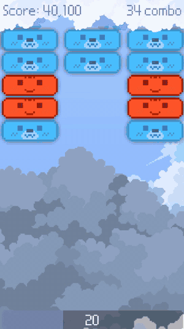

**핵심 플레이 루프**


| 요소 | 조건 | 효과 | 규칙 |
|---|---|---|---|
| 레벨 | 매치 10번마다 | 나오는 색이 2종에서 6종까지 늘어남 | 직접 정함 |
| 피버 | 피버 게이지가 다 참 | 블록 보충이 빨라지고 배경·음악이 바뀜 | 원작 참고 |
| 슈퍼 피버 | 피버 중 게이지가 다시 다 참 | 판을 비우고 두 가지 색으로 다시 채움 | 원작에서 바꿈 (슈퍼 피버 내내 두 가지 색) |
| 폭탄 블록 | 폭탄 게이지가 다 참 | 사용하면 모든 줄에서 앞 블록을 3개까지 제거 | 직접 정함 |
| 시간 연장 | 매치할 때마다 | 남은 시간 +1초 | 직접 정함 |

**조작법**

| 조작 | 키 |
|---|---|
| 맨 앞 블록 고르기 | 블록이 있는 줄 클릭 |
| 고른 블록 옮기기 | 다른 줄 클릭 |
| 고른 블록 취소 | 같은 줄 다시 클릭 |
| 다시 시작 | 게임 오버 뒤 아무 키 |

### 1.3 플레이어에게 주고 싶었던 경험

플레이어가 **블록 배치를 빠르게 파악하고, 연속으로 맞춰 피버를 터뜨리는 경험**을 하길 바랐습니다. 

그래서 블록이 한눈에 들어오도록 화면 구성은 단순하게 두고, **블록이 나오는 방식으로 난이도를 조절**하는 데 집중했습니다(2.1).

### 1.4 이 문서가 다루는 것

이 문서는 **블록 생성 규칙**, **줄 조작과 블록 풀**, **피버 진행**을 만들며 제가 부딪힌 문제와 그 해결 과정을 다룹니다.

| 장 | 내용 |
|---|---|
| 2 | 설계 목표와 풀어야 했던 문제 |
| 3 | 시스템 구조, 매니저를 싱글턴으로 둔 이유 |
| 4 | 핵심 기능: 색 가중치, 막히지 않는 판, 줄 조작과 블록 풀, 게이지와 피버 모드 |
| 5 | 트러블슈팅 2건 |
| 6 | 결과, 아쉬운 점과 개선 계획, 배운 점 |

---

## 2. 설계 목표와 풀어야 했던 문제

### 2.1 설계 목표

| 순위 | 목표 |
|---|---|
| 1 | 맞출 수 있는 블록이 끊기지 않는 판 |
| 2 | 쉽게 시작해 점점 어려워지는 난이도 |
| 3 | 빠르게 연속으로 맞춰 피버를 터뜨리는 재미 |
| 4 | 작은 규모에 맞는 빠른 개발 |

### 2.2 풀어야 했던 문제

| 문제 | 상황 | 다루는 절 |
|---|---|---|
| 색이 조금만 늘어도 급격히 어려워지는 난이도 | 색을 균등한 확률로 고르면, 나오는 색 종류가 조금만 늘어도 난이도가 급격히 오름 | 4.1 |
| 맞출 블록이 없는 판 | 보충되는 색이 무작위라, 화면 전체에 같은 색이 세 개도 없는 판이 생김 | 4.2 |
| 수가 정해진 블록의 반복 생성·파괴 | 한 줄 최대 12칸, 세 줄이라 화면의 블록은 최대 36개로 정해져 있음 | 4.3 |
| 연속으로 못 맞춰도 쉽게 오는 피버 | 매치 횟수만 쌓이면, 빠르게 이어서 맞추지 못해도 피버와 폭탄 블록이 쉽게 나옴 | 4.4 |

---

## 3. 시스템 구조

### 3.1 전체 구조

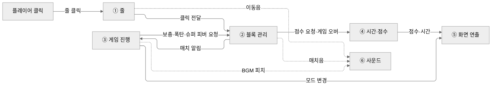

클릭은 ① 줄을 거쳐 ② 블록 관리 한 곳에서 처리되고, 매치 결과는 ③ 게임 진행과 ④ 시간·점수로 전해집니다. ③은 블록을 직접 만들지 않고 ②에 보충을 요청합니다.

| 번호 | 구성요소 | 책임 |
|---|---|---|
| ① | 줄 | 블록 최대 12개의 순서와 위치, 앞 3개 같은 색 판정과 제거. 블록을 고르거나 만들지 않음 |
| ② | 블록 관리 | 클릭 처리(선택·이동·취소), 블록 풀, 색 고르기와 보충, 폭탄 사용. 레벨과 모드는 ③에서 읽기만 함 |
| ③ | 게임 진행 | 주기 보충 타이머, 레벨, 피버·폭탄 게이지, 모드 전환 |
| ④ | 시간·점수 | 제한 시간, 콤보, 점수, 게임 오버와 재시작 |
| ⑤ | 화면 연출 | 점수·시간 UI, 모드별 배경, 피버 연출, 게임 오버 화면. 규칙은 판단하지 않음 |
| ⑥ | 사운드 | 효과음 재생, 이동음 겹침 제어, 모드별 BGM 피치 |

### 3.2 클래스 구조

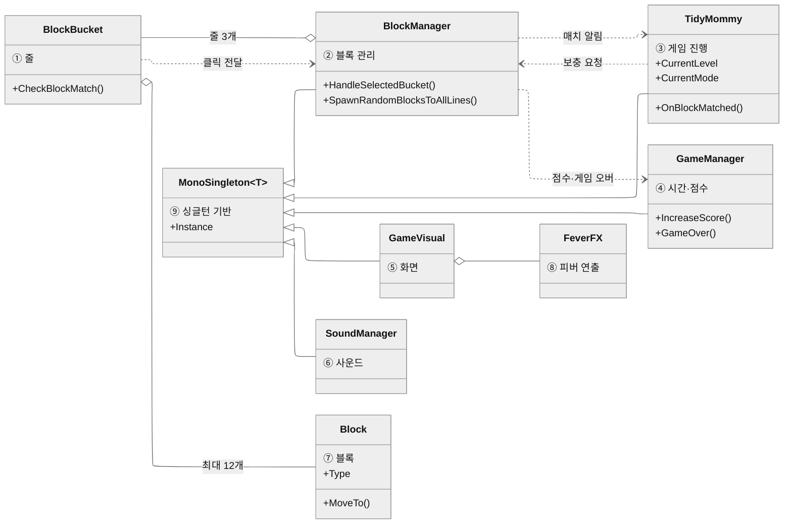

번호는 3.1과 같습니다. 블록과 진행 규칙은 ② 블록 관리와 ③ 게임 진행이, 시간과 점수는 ④가 정합니다. ① 줄과 ⑦ 블록은 받은 요청대로 배치하고 움직이며, ⑤·⑥·⑧은 받은 값을 보여 주거나 들려주기만 합니다.

| 번호 | 클래스 | 맡는 일 | 다른 곳에 맡긴 일 |
|---|---|---|---|
| ① | `BlockBucket` | 줄 하나의 블록 순서, 칸 위치 계산, 앞 3개 판정과 제거, 클릭 받기 | 클릭 뒤 할 일 결정 (→ ②) |
| ② | `BlockManager` | 클릭 처리, 블록 풀, 색 고르기, 보충, 폭탄 사용 | 줄 안의 배치와 매치 판정 (→ ①), 레벨·모드 결정 (→ ③) |
| ③ | `TidyMommy` | 주기 보충 타이머, 레벨, 피버·폭탄 게이지, 모드 전환과 적용 | 블록 생성·제거 (→ ②) |
| ④ | `GameManager` | 제한 시간, 콤보, 점수, 게임 오버와 재시작 | 화면 표시 (→ ⑤) |
| ⑤ | `GameVisual` | 점수·시간·콤보 UI, 모드별 배경, 게임 오버 화면 | 피버 진입 연출 (→ ⑧) |
| ⑥ | `SoundManager` | 효과음 재생, 이동음 겹침 제어, 모드별 BGM 피치 | 재생 시점 판단 (→ 부르는 쪽) |
| ⑦ | `Block` | 색과 소속 줄 보관, 칸 사이 이동, 선택 외곽선 표시 | 어느 칸으로 갈지 결정 (→ ①) |
| ⑧ | `FeverFX` | 피버·슈퍼 피버 진입 시 화면 번쩍임과 글자 연출 | 모드 판단 (→ ③) |
| ⑨ | `MonoSingleton<T>` | 씬에 하나뿐인 매니저를 `Instance`로 제공 | 게임 규칙 (→ ②③④) |

### 3.3 매니저를 싱글턴으로 둔 이유

블록 관리, 게임 진행, 시간·점수, 화면, 사운드 다섯 매니저는 `MonoSingleton<T>`을 상속하고 서로를 주로 `Instance`로 부릅니다. 줄에서 블록 관리로, 블록 관리에서 카메라 흔들림으로 가는 것처럼 매니저가 아닌 오브젝트 사이의 연결은 인스펙터 참조로 둡니다.

처음에는 싱글턴을 쓰는 게 맞는지 확신이 없었습니다. 흔히 말하는 **싱글턴 남용** 문제가 마음에 걸려, 매니저끼리 부르는 방식을 인스펙터 참조와 싱글턴 사이에서 여러 번 오갔습니다. 강사님께 여쭤, 스스로 명확히 제어할 수 있다면 싱글턴이 개발 편의성을 높여 준다는 답을 들었습니다. 이 프로젝트는 규모가 작고 다섯 매니저가 게임 내내 하나씩 쓰이므로, 참조를 일일이 연결하는 것보다 `Instance`로 가져다 쓰는 쪽이 **개발 속도를 높인다고 판단**해 싱글턴으로 정했습니다.

| | 인스펙터 참조 | 싱글턴 (선택) |
|---|---|---|
| 참조를 얻는 방법 | 필드를 만들어 씬에서 연결하거나 `GetComponent`로 찾음 | `클래스.Instance`로 바로 접근 |
| 매니저 사이 호출을 더할 때 | 부르는 쪽마다 필드를 만들고 씬에서 다시 연결 | 코드 한 줄 |
| 어울리는 대상 | 여러 개이거나 씬마다 바뀌는 객체 | 게임 내내 하나만 쓰이는 매니저 |

매치가 일어난 뒤에도 같은 방식으로 이어집니다. 블록 관리가 "매치됨"을 알릴 때 이벤트를 쓰지 않고, 반응해야 하는 매니저를 `Instance`로 차례로 직접 부릅니다.

```csharp
private void OnBlockMatched()
{
    TrySpawnBlocksWhenMatched();

    TidyMommy.OnBlockMatched();
    GameManager.Instance.IncreaseScore();

    cameraShake.Shake();
    SoundManager.Instance.PlayBlockMatchSFX(isBomb: false);
}
```

| | 이벤트 | 직접 호출 (선택) |
|---|---|---|
| 방식 | 블록 관리가 "매치됨" 이벤트를 발행하고, 필요한 쪽이 구독 | 반응할 매니저를 `Instance`로 찾아 차례로 호출 |
| 장점 | 발행하는 쪽이 받는 쪽을 몰라도 됨. 반응을 더할 때 블록 관리를 고치지 않음 | 호출 순서가 코드에 그대로 드러나 따라가기 쉬움 |
| 단점 | 호출 흐름이 코드에 바로 보이지 않음. 구독 해제를 관리해야 함 | 부르는 쪽이 받는 쪽을 모두 알아야 함 |

이벤트를 쓰지 않는 개발 조건(1.1) 때문에, 블록 관리는 매치 뒤에 반응하는 대상을 모두 알고 있어야 합니다. 예를 들어 매치 횟수로 업적을 세려면 `OnBlockMatched`를 직접 고쳐야 합니다(6.2).

---

## 4. 핵심 기능

### 4.1 화면 블록 수에 따른 색 가중치

| 항목 | 내용 |
|---|---|
| 목적 | 색 종류가 늘어도 급격히 어려워지지 않고, 쉽게 시작해 점점 어려워지는 난이도 |
| 방식 | 화면에 많은 색일수록 잘 나오게 가중치를 두고, 레벨이 오르면 가중치의 지수를 낮춤 |
| 결과 | 레벨 5까지는 색이 늘어도 같은 색이 잘 모이고, 레벨 8에서 모든 색이 고르게, 레벨 9부터는 적은 색이 더 잘 나옴 |

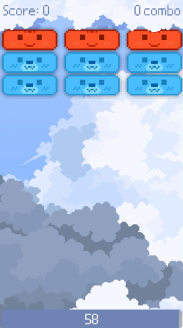

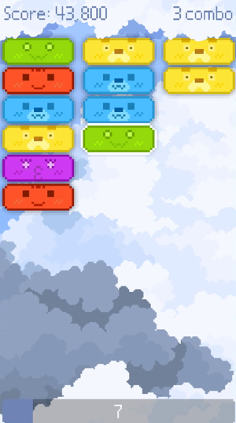

#### 동작 방식

**가중치** 는 새 블록의 색을 고를 때 색마다 붙는 "뽑힐 몫"입니다. 줄에 블록을 하나 놓을 때마다 화면의 블록을 색별로 세고, 그 수로 가중치를 계산해 비율대로 한 색을 뽑습니다.

| 넣는 것 | 나오는 것 |
|---|---|
| 지금 레벨, 화면에 있는 색별 블록 수 | 새로 놓을 블록의 색 |

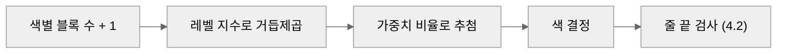

가중치는 "블록 수 + 1"을 레벨별 지수로 거듭제곱한 값입니다. 지수가 클수록 화면에 많은 색이 더 잘 뽑히고, 0이면 모든 색이 같아지며, 음수가 되면 오히려 적은 색이 잘 뽑힙니다.

| 레벨 | 나오는 색 | 지수 | 경향 |
|---|---|---|---|
| 1~5 | 2종에서 6종까지 하나씩 늘어남 | 2 | 많은 색 우대 |
| 6 | 6종 | 1.5 | 많은 색 우대 (약해짐) |
| 7 | 6종 | 1 | 블록 수에 비례 |
| 8 | 6종 | 0 | 모든 색 같음 |
| 9 / 10 | 6종 | −0.25 / −0.5 | 적은 색 우대 |

레벨 5까지는 색 종류가 늘어나는 동안 지수를 2로 두어 같은 색이 계속 잘 모이게 하고, 색이 다 나온 레벨 6부터는 지수를 낮춰 난이도를 올립니다.

#### 가중치를 계산하는 규칙

```csharp
private Dictionary<BlockType, float> BuildSpawnWeights(Dictionary<BlockType, int> counts, out float totalWeight)
{
    totalWeight = 0f;
    Dictionary<BlockType, float> weights = DictionaryPool<BlockType, float>.Get();

    Level level = TidyMommy.CurrentLevel;
    float exponent = GetLevelExponent(level);

    foreach (var count in counts)
    {
        // counts에는 색마다 "화면의 블록 수 + 1"이 들어 있음
        float weight = Mathf.Pow(count.Value, exponent);

        weights[count.Key] = weight;
        totalWeight += weight;
    }

    return weights;
}

private float GetLevelExponent(Level level)
{
    return level switch
    {
        Level.Six => 1.5f,
        Level.Seven => 1f,
        Level.Eight => 0f,
        Level.Nine => -0.25f,
        Level.Ten => -0.5f,
        _ => 2f
    };
}
```

- 블록 수를 1부터 세므로, 화면에 하나도 없는 색도 가중치가 0이 되지 않아 나올 수 있음
- 레벨 1~5는 기본값 2, 레벨 6부터 지수만 바꿔 난이도를 조절함
- 임시 딕셔너리는 `DictionaryPool`에서 빌려 쓰고 추첨이 끝나면 돌려줌

#### 설계 선택 ①: 난이도를 줄 수로 올릴 것인가

레벨이 오를 때 줄을 늘려 난이도를 올리는 방법도 있었습니다.

| | 줄 추가 | 3줄 고정 (선택) |
|---|---|---|
| 방식 | 레벨이 오르면 줄을 4줄, 5줄로 늘림 | 줄은 그대로 두고, 나오는 색의 수와 확률로 조절 |
| 장점 | 난이도가 오른 것이 눈에 바로 보임 | 블록 크기와 화면 구성이 끝까지 유지됨 |
| 단점 | 화면에 맞추려면 블록을 줄여야 해 잘 보이지 않음 | 난이도 조절을 색 설계에 맡겨야 함 |

이 게임의 재미는 **블록을 빠르게 파악하고 정리하는 것**인데, 줄이 늘어 블록이 작아지면 바로 그 파악이 어려워지기 때문에 3줄로 고정했습니다. 그 대신 난이도를 올릴 수단이 색에 몰려, 색을 어떻게 뽑느냐가 중요해졌습니다. 줄 수가 고정이라 화면에 있을 수 있는 블록도 최대 36개로 정해졌습니다(4.3).

#### 설계 선택 ②: 색을 같은 확률로 뽑을 것인가

처음에는 나올 수 있는 색 가운데 하나를 `Random.Range`로 같은 확률로 골랐습니다. 그러자 **나오는 색 종류가 조금만 늘어도 난이도가 급격히 올라갔습니다.** 그래서 화면에 많은 색이 더 잘 나오도록 가중치를 두어, 초반에는 쉽게 시작하고 후반으로 갈수록 어려워지게 바꿨습니다.

| | 균등 랜덤 (이전) | 블록 수 가중치 (현재) |
|---|---|---|
| 색을 고르는 기준 | 나올 수 있는 색끼리 같은 확률 | 화면에 그 색이 많을수록 높은 확률 |
| 색 종류가 늘 때 | 한 색이 나올 확률이 "1 ÷ 색 수"로 바로 떨어짐 | 화면에 많은 색은 계속 높은 확률을 유지 |
| 난이도를 조절하는 수단 | 색 종류 수 | 색 종류 수 + 지수 |


같은 판이라도 레벨 5에서는 가장 많은 빨강이 40%, 없는 흰색이 1%이고, 레벨 10에서는 반대로 흰색이 27%, 빨강이 11%가 됩니다. 지수가 0인 레벨 8이 이전의 균등 랜덤과 같으므로, 레벨 1~7은 이전보다 쉽고 레벨 9~10은 더 어렵습니다.

### 4.2 막히지 않는 판 만들기

| 항목 | 내용 |
|---|---|
| 목적 | 맞출 수 있는 블록이 끊기지 않는 판 |
| 방식 | 줄 끝 두 블록과 같은 색은 다시 뽑고, 보충 뒤 화면에 같은 색이 세 개도 없으면 한 줄 더 보충 |
| 결과 | 저절로 생긴 같은 색 세 개가 줄에 남지 않고, 화면에는 늘 같은 색이 세 개 이상 있음 |

#### 동작 방식

줄의 **맨 앞**은 플레이어가 고르고 옮겨 넣는 쪽이고, **줄 끝**은 새 블록이 들어오는 쪽입니다. 블록은 세 줄에 한 칸씩 동시에 보충되며, 플레이 중에는 주로 다음 때 보충됩니다.

| 보충 시점 | 양 |
|---|---|
| 5초마다 (피버 1.5배, 슈퍼 피버 2배 빠르게. 매치하면 다시 0초부터) | 줄마다 한 칸 |
| 매치할 때 | 90% 확률로 줄마다 한 칸 |
| 화면에 같은 색이 세 개 이상인 색이 없을 때 | 생길 때까지 줄마다 한 칸씩 |

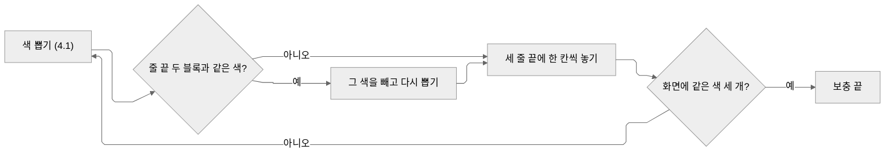

블록 하나를 놓기 전에 줄 끝을 보고, 세 줄에 한 칸씩 다 놓은 뒤에 화면 전체를 봅니다. 줄에 빈칸이 없어 블록을 놓지 못하면 그 자리에서 게임이 끝납니다.

#### 색을 다시 뽑고 더 보충하는 규칙

```csharp
private BlockType GetNextSpawnType(bool isGetLastTwoTypes, BlockType t1, BlockType t2)
{
    Dictionary<BlockType, int> counts = GetBlockCounts();
    Dictionary<BlockType, float> weights = BuildSpawnWeights(counts, out float totalWeight);

    BlockType candidate = GetBlockTypeByWeight(weights, totalWeight);

    DictionaryPool<BlockType, int>.Release(counts);
    DictionaryPool<BlockType, float>.Release(weights);

    if (isGetLastTwoTypes == false) return candidate; //해당 버킷에 블럭이 2개 미만일 경우
    if (WouldCreateMatch(candidate, t1, t2) == false) return candidate;

    return GetBlockTypeExcluding(candidate);
}
```

- 줄 끝 두 블록과 같은 색이 뽑히면 그 색만 빼고 나머지 색 가운데 같은 확률로 다시 고름
- 줄에 블록이 둘보다 적으면 세 개가 붙을 수 없으므로 검사하지 않음

```csharp
private void SpawnRandomBlocksIfNoMatches()
{
    Dictionary<BlockType, int> counts = GetBlockCounts(false);

    bool isValid = false;

    foreach (var count in counts.Values)
    {
        if (count >= BlockBucket.MATCH_BLOCK_COUNT)
        {
            isValid = true;
            break;
        }
    }

    DictionaryPool<BlockType, int>.Release(counts);

    if (isValid) return;

    SpawnRandomBlocksToAllLines();
    SpawnRandomBlocksIfNoMatches();
}
```

- 이번에는 1을 더하지 않고(`false`) 화면에 실제로 있는 블록만 셈
- 같은 색이 세 개 이상인 색이 하나라도 있으면 끝, 없으면 한 줄 더 놓고 다시 검사함

#### 예시: 줄에 같은 색 블록이 두 개뿐인 경우

| 순서 | 상황 | 보충 처리 |
|---|---|---|
| 1 | 한 줄에 빨강 두 개만 있음 | 줄 끝 두 블록 = 빨강, 빨강 |
| 2 | 다음 색으로 빨강이 뽑힘 | 빨강을 빼고 다른 색 가운데 다시 뽑아 파랑을 놓음 |
| 3 | 줄이 빨강, 빨강, 파랑이 됨 | 플레이어가 맞추지 않은 같은 색 세 개가 생기지 않음 |

이 검사가 없으면 3번에서 빨강 세 개가 줄 앞에 나란히 놓입니다. 매치 판정은 블록을 옮겨 넣을 때만 하므로 이 세 개는 지워지지 않고 남고, 맨 앞 블록을 뺐다가 다시 넣기만 해도 공짜로 매치됩니다.

#### 설계 선택: 매치할 때마다 보충할 것인가

맞출 때마다 블록을 한 줄씩 보충하니 너무 어려웠고, 보충을 빼면 게임이 너무 루즈해졌습니다. 그래서 둘 사이에 확률을 두었습니다.

| | 매번 보충 | 보충 없음 | 확률 보충 (선택) |
|---|---|---|---|
| 매치 뒤 보충 | 항상 한 줄 | 없음 (5초 주기 보충만) | 90% 확률로 한 줄 |
| 플레이 | 너무 어려움 | 너무 루즈함 | 두 경우 사이 |

### 4.3 줄 조작과 블록 풀

| 항목 | 내용 |
|---|---|
| 목적 | 블록 선택·이동·매치를 한 흐름으로 처리하고, 수가 정해진 블록을 다시 쓰기 |
| 방식 | 줄 클릭을 블록 관리 한 곳에서 분기하고, 씬에 미리 둔 블록 36개를 큐로 꺼내고 돌려줌 |
| 결과 | 플레이 중 블록을 새로 만들거나 파괴하지 않음 |

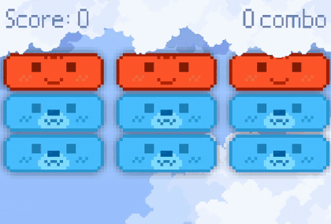

#### 동작 방식

**줄**은 블록이 최대 12개까지 한 줄로 쌓이는 칸입니다. 플레이어는 블록이 아니라 줄을 클릭하고, 클릭은 모두 블록 관리(`BlockManager`)의 한 함수로 모입니다. 그 함수는 지금 고른 블록이 있는지와 클릭한 줄의 상태를 보고 할 일을 정합니다.

| 고른 블록 | 클릭한 줄 | 처리 |
|---|---|---|
| 없음 | 블록이 있는 줄 | 그 줄 맨 앞 블록을 고르고 외곽선 표시 |
| 없음 | 빈 줄 | 무시 |
| 있음 | 같은 줄 | 고르기 취소 |
| 있음 | 꽉 찬 다른 줄 | 무시 |
| 있음 (폭탄) | 빈칸이 있는 다른 줄 | 폭탄 사용 (4.4) |
| 있음 | 빈칸이 있는 다른 줄 | 그 줄 맨 앞에 끼우고, 앞 세 개가 같은 색인지 판정 |

매치 판정은 블록을 옮겨 넣은 줄에서만, 옮겨 넣은 직후에만 합니다. 블록이 들어오면 줄은 모든 블록의 칸 위치를 다시 계산하고, 각 블록은 새 칸으로 0.15초 동안 미끄러지듯 이동합니다. 이동 중에 새 칸이 정해지면 진행 중인 이동을 멈추고 바로 새 칸으로 출발해, 입력에 즉시 반응합니다.

#### 줄 안의 배치와 판정 코드

```csharp
private void ReorderActiveBlockPositions()
{
    // 리스트의 마지막(줄 끝)부터 첫 칸에 놓아, 0번(맨 앞)이 가장 먼 칸에 감
    int blockPosIdx = 0;
    for (int i = activeBlocks.Count - 1; i >= 0; i--)
    {
        Block block = activeBlocks[i];
        Vector3 movePos = blockPositions[blockPosIdx++];
        block.MoveTo(movePos);
    }
}

private bool IsLastThreeConsecutiveSame()
{
    if (activeBlocks.Count < MATCH_BLOCK_COUNT) return false;

    BlockType refType = activeBlocks[0].Type;

    for (int i = 1; i < MATCH_BLOCK_COUNT; i++)
    {
        BlockType type = activeBlocks[i].Type;

        if (refType != type)
            return false;
    }
    return true;
}
```

- 리스트 0번이 맨 앞이라, 옮겨 온 블록은 0번에 끼우고(`Insert(0, …)`) 보충 블록은 끝에 붙임(`Add`)
- 판정은 0~2번, 즉 맨 앞 세 개만 봄

#### 블록 풀

한 줄에 최대 12개, 줄이 세 개라 화면에 있을 수 있는 블록은 최대 36개입니다. **최대 수가 정해져 있으니 생성과 파괴를 반복할 이유가 없다고 보고**, 씬에 블록 36개를 미리 두고 큐에서 꺼내 쓰고 돌려주는 풀로 만들었습니다.

```csharp
private void InitAndEnqueueBlocks()
{
    int blockCount = blockContainer.childCount;

    for (int i = 0; i < blockCount; i++)
    {
        Block block = blockContainer.GetChild(i).GetComponent<Block>();

        block.Initialize(this);
        EnqueueBlock(block);
    }
}

public void EnqueueBlock(Block block)
{
    blockQueue.Enqueue(block);

#if UNITY_EDITOR
    if (block.transform.parent != blockContainer)
    {
        block.transform.SetParent(blockContainer);
        block.transform.localPosition = Vector3.zero;
    }
#endif
}
```

- 시작할 때 컨테이너 아래 블록 36개를 모두 큐에 넣음. 보충할 때 큐에서 꺼내 색과 줄을 정해 켜고, 매치·폭탄으로 지울 때 끄고 큐에 돌려줌
- 부모 오브젝트를 바꾸는 일은 에디터에서만 함. 에디터에서는 하이어라키를 보기 좋게 정리하고, 빌드에서는 정리할 필요가 없어 뺌

#### 설계 선택: 블록을 그때그때 만들 것인가

| | 필요할 때 생성·파괴 | 미리 두고 다시 쓰기 (선택) |
|---|---|---|
| 블록을 얻는 방법 | 보충할 때 `Instantiate`, 지울 때 `Destroy` | 씬에 둔 블록을 큐에서 꺼내 켜고, 지울 때 끄고 돌려줌 |
| 메모리 할당 | 생성·파괴 때마다 할당과 가비지가 생김 | 시작할 때 한 번 |
| 블록 수 | 제한 없음 | 36개로 고정 (줄 3개 × 12칸) |
| 준비 | 프리팹 하나 | 씬에 블록 36개를 미리 배치 |

### 4.4 줄어드는 게이지와 피버 모드

| 항목 | 내용 |
|---|---|
| 목적 | 빠르게 이어서 맞출 때만 피버와 폭탄 블록이 나오는 진행 |
| 방식 | 매치마다 게이지 +1, 시간이 지나면 게이지가 줄어듦. 게이지가 차면 모드가 한 단계 오르거나 폭탄 블록이 나옴 |
| 결과 | 매치 사이가 길어지면 게이지가 줄어 피버와 폭탄 블록이 나오지 않음 |

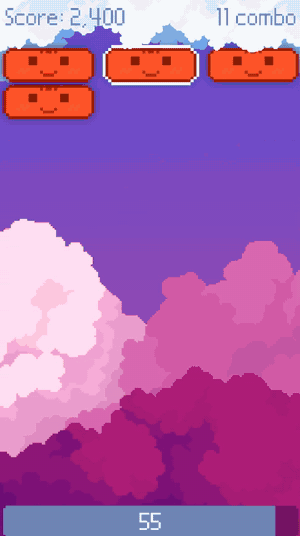

#### 동작 방식

**게이지** 는 매치할 때마다 1씩 차고, 매치하지 않는 동안 1초에 0.15씩 줄어드는 값입니다. 게이지는 피버용과 폭탄용 두 개가 있고, 둘 다 5가 되면 발동합니다. 줄어들지 않는다면 천천히 맞춰도 다섯 번이면 발동하지만, 지금은 매치 사이가 약 6.7초를 넘으면 게이지가 쌓이지 않습니다. 그래서 **이어서 빠르게 맞춰야만** 피버와 폭탄 블록이 나옵니다.

| 게이지 | 5가 되면 |
|---|---|
| 피버 | 모드가 한 단계 오름 (일반 → 피버 → 슈퍼 피버) |
| 폭탄 | 빈칸이 있는 줄 하나에 폭탄 블록이 나옴 |

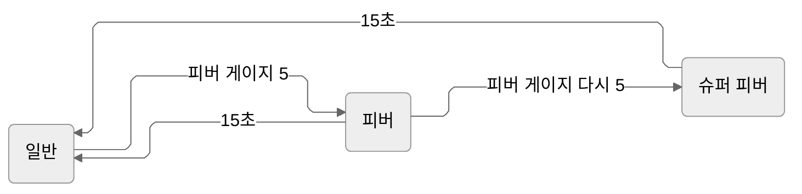

피버에 들어가면 게이지가 0부터 다시 차므로, 15초 안에 게이지를 다시 5까지 채워야 슈퍼 피버로 올라갑니다. 모드가 바뀌면 아래 값이 한 번에 바뀝니다.

| 모드 | 블록 보충 | 나오는 색 | 화면·소리 |
|---|---|---|---|
| 일반 | 기본 속도 | 레벨대로 (4.1) | 기본 배경, 기본 BGM |
| 피버 | 1.5배 빠르게 | 레벨대로 | 진입 연출, 배경 교체·빠른 스크롤, BGM 피치 1.15 |
| 슈퍼 피버 | 2배 빠르게 | 빨강·파랑 두 가지 | 진입 연출, 배경 교체·더 빠른 스크롤, BGM 피치 1.3 |

#### 게이지와 모드 코드

```csharp
private void UpdateGauge(ref float gauge, float speed)
{
    if (gauge == 0f) return;

    float decreaseAmount = Time.deltaTime * speed;
    gauge = Mathf.Max(0, gauge - decreaseAmount);
}

private void IncreaseFeverGauge()
{
    feverGauge += 1f;

    if (feverGauge >= feverUnit)
    {
        CurrentMode = (Mode)((int)CurrentMode + 1);
        ApplyMode();

        feverGauge = 0f;
        feverTimer = 0f;
    }
}
```

- 피버 게이지와 폭탄 게이지가 같은 감소 함수를 `ref`로 넘겨 씀
- 모드가 오르면 게이지와 모드 타이머를 모두 0으로 되돌림

```csharp
private void ApplyMode()
{
    spawnSpeed = CurrentMode switch
    {
        Mode.Fever => 1.5f,
        Mode.SuperFever => 2f,
        _ => 1f
    };

    if (CurrentMode == Mode.SuperFever)
        SuperFever();

    Visual.UpdateFever(CurrentMode);
    SoundManager.Instance.SetBGMPitch(CurrentMode);
}

private void SuperFever()
{
    int removeCount = BlockBucket.MAX_BLOCKS_PER_BUCKET;
    BlockManager.RemoveBlocksFromAllLines(removeCount);

    BlockManager.SpawnBlocksToAllLines(BlockType.Red, 2);
    BlockManager.SpawnBlocksToAllLines(BlockType.Blue, 2);
    BlockManager.SpawnBlocksToAllLines(BlockType.Red, 2);
}
```

- 보충 속도, 화면, BGM을 모드가 바뀌는 한 곳에서 함께 바꿈
- 슈퍼 피버에 들어가면 모든 줄을 비우고, 줄마다 빨강 2·파랑 2·빨강 2 순으로 다시 채움
- 슈퍼 피버 동안에는 빨강·파랑만 나오게 해, 블록을 빠르게 연달아 처리하는 쾌감이 가장 큰 구간으로 만듦. BGM 피치와 배경 스크롤도 같은 목적으로 함께 올림
- 슈퍼 피버 중의 매치는 레벨과 게이지를 올리지 않고, 폭탄 게이지도 멈춤

#### 폭탄 블록

폭탄 블록은 일반 블록처럼 맨 앞에서 골라 다른 줄을 클릭하면 쓰입니다(4.3의 표).

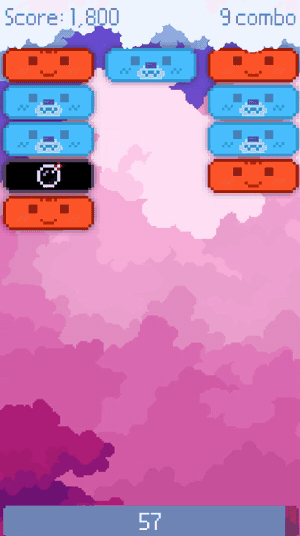

| 요소 | 내용 |
|---|---|
| 나오는 곳 | 빈칸이 있는 줄 가운데 무작위 한 줄의 끝 |
| 사용 효과 | 폭탄을 지우고, 모든 줄에서 맨 앞 블록을 3개까지 지움 |
| 사용 뒤 | 블록을 1~2줄 보충하고 화면을 크게 흔듦 |

---

## 5. 트러블슈팅

### 5.1 정기 보충과 매치 보충이 겹쳐 블록이 두 칸씩 쌓임

| | 내용 |
|---|---|
| 현상 | 매치 직후 블록이 줄마다 한꺼번에 두 칸씩 쌓이는 경우가 있음 |
| 원인 | 5초 주기 보충 타이머가 매치와 상관없이 계속 흐름. 매치 때의 보충(4.2) 직후에 타이머가 차면 보충이 연달아 일어남 |
| 해결 | 매치할 때마다 주기 보충 타이머를 0으로 되돌림. 템포는 유지하면서 보충이 몰리지 않게 함 |

```csharp
public void OnBlockMatched()
{
    spawnTimer = 0f; //매치 될 때마다 타이머 초기화

    if (CurrentMode == Mode.SuperFever) return;

    AdvanceLevelUpCount();
    IncreaseBombSpawnGauge();
    IncreaseFeverGauge();
}
```

### 5.2 매치 직후 효과음이 겹쳐 순간적으로 크게 울림

| | 내용 |
|---|---|
| 현상 | 매치되어 블록이 터지는 소리와 이어서 블록이 보충되며 나는 소리가 겹쳐, 순간적으로 지나치게 커짐. 플레이 테스트에서 발견 |
| 원인 | 줄에 블록이 들어오면 그 줄의 모든 블록이 새 칸으로 이동하고(4.3), 블록마다 이동음을 따로 재생함. 매치 한 번에 옮긴 줄과 보충된 세 줄이 모두 다시 배치되므로, 화면의 블록 수만큼 이동음이 한꺼번에 겹치고 매치음과도 겹침 |
| 해결 | 이동음에 0.1초 쿨다운을 두어, 그 안에 들어온 요청은 버림 |
| 배운 점 | 효과음을 내는 오브젝트가 여러 개일 때는 각자 재생하게 두지 말고, 재생 여부를 한 곳에서 판단해야 겹침을 제어할 수 있음 |

```csharp
public void PlayBlockMoveSFX()
{
    float nowTime = Time.time;
    float movePlayTimePassed = nowTime - lastMovePlayTime;

    if (movePlayTimePassed < moveCooldown) return;

    lastMovePlayTime = nowTime;

    // ...

    seSource.PlayOneShot(blockMoveClip, volumeScale);
}
```

- 한 프레임 안의 요청은 같은 시각이라, 첫 번째만 재생되고 나머지는 모두 버려짐
- 블록이 아무리 많이 움직여도 이동음은 쿨다운마다 한 번만 남음

---

## 6. 결과 및 배운 점

### 6.1 결과

| 문제 (2.2) | 결과 |
|---|---|
| 색이 조금만 늘어도 급격히 어려워지는 난이도 | 레벨 5까지는 색이 늘어도 같은 색이 잘 모이고, 레벨 6부터 점점 어려워짐 (4.1) |
| 맞출 블록이 없는 판 | 보충이 끝나면 화면에 같은 색이 늘 세 개 이상 있음 (4.2) |
| 수가 정해진 블록의 반복 생성·파괴 | 플레이 중 블록을 새로 만들거나 파괴하지 않음 (4.3) |
| 연속으로 못 맞춰도 쉽게 오는 피버 | 매치 사이가 약 6.7초를 넘으면 게이지가 쌓이지 않음 (4.4) |

### 6.2 아쉬운 점과 개선 계획

문서를 정리하며 코드를 다시 보다 찾은 문제와, 당시 조건 때문에 남겨 둔 부분을 모았습니다.

| 아쉬운 점 | 당시 판단 | 개선 계획 |
|---|---|---|
| **줄이 가득 찰 때 게임 오버가 나지 않을 수 있음.** 보충할 때 큐에서 블록을 먼저 꺼낸 뒤 자리를 확인해, 1번 줄 11개·2·3번 줄 12개일 때 빈 큐에서 꺼내다 예외가 남 (4.3) | 문서를 정리하며 코드를 다시 보다 발견 | 자리를 먼저 확인하고, 있을 때만 꺼냄 (아래 코드) |
| **매니저 사이의 결합도.** 매치 뒤 반응할 대상을 블록 관리가 모두 직접 부름 (3.3) | 이벤트를 가능하면 쓰지 않는다는 강사님의 개발 조건을 따름 | "매치됨" 이벤트를 발행하고 진행·점수·사운드가 구독 |
| **지수 값의 근거가 약함** (4.1) | 플레이로는 레벨 사이 차이가 잘 구분되지 않아 AI의 도움을 받아 정함 | 레벨별 평균 매치 횟수·생존 시간을 기록해 곡선을 검증 |
| **밸런스 값이 코드에 고정됨.** 레벨별 지수·색 수, 모드별 보충 배율·BGM 피치, 슈퍼 피버 배치 (4.1, 4.4) | `switch` 문과 코드에 직접 씀 | ScriptableObject 데이터로 분리해 코드 수정 없이 조정 |
| **규모에 비해 앞선 설계.** 구현체가 하나뿐인 `IBlockPool` 인터페이스, 측정 없이 쓴 `DictionaryPool`·`ListPool` (4.1) | 필요가 확인되기 전에 넣음 | 인터페이스는 구현체가 둘 이상 필요할 때, 최적화는 프로파일러로 문제를 확인한 뒤 도입 |

```csharp
// 지금: 먼저 꺼낸 뒤 자리를 확인
Block block = blockQueue.Dequeue();
// ...
if (block.TryActive(spawnType, bucket) == false) { GameManager.Instance.GameOver(); return; }

// 개선: 자리를 먼저 확인하고, 있을 때만 꺼냄
if (bucket.HasAvailableSpace == false) { GameManager.Instance.GameOver(); return; }
Block block = blockQueue.Dequeue();
block.Active(spawnType, bucket);
```

### 6.3 배운 점

**난이도는 색의 "개수"만이 아니라 "분포"로도 조절할 수 있다.** 나오는 색의 수를 늘리는 것만으로는 난이도가 급격히 올랐습니다. 어떤 색이 나올 확률까지 조절하자, 지수 하나로 쉽게 시작해 점점 어려워지는 곡선을 만들 수 있었습니다(4.1).

**설계와 최적화는 규모에 맞춰야 한다.** 필요가 확인되기 전에 넣은 인터페이스와 컬렉션 풀링은 이 규모에서는 이득이 분명하지 않았습니다. 이런 구조는 필요가 확인된 시점에 들이는 편이 낫다는 것을 배웠습니다(6.2).
