# ODDITY — 보스 AI·전투 기반 기술 문서

> 염동력과 증강칩 스킬로 세 보스와 맞서는 3인칭 보스 액션 게임

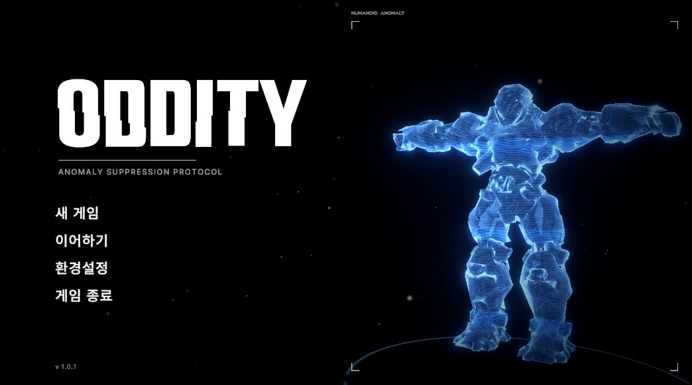

## 목차

- [1. 프로젝트 개요](#1-프로젝트-개요)
   - [1.1 기본 정보](#11-기본-정보)
   - [1.2 무엇을 만들었나](#12-무엇을-만들었나)
   - [1.3 왜 만들었나](#13-왜-만들었나)
   - [1.4 이 문서가 다루는 것](#14-이-문서가-다루는-것)
- [2. 팀 구성과 내 역할](#2-팀-구성과-내-역할)
   - [2.1 역할 분담](#21-역할-분담)
   - [2.2 내가 작성한 범위](#22-내가-작성한-범위)
- [3. 전체 구조와 파트 간 연결](#3-전체-구조와-파트-간-연결)
   - [3.1 전체 구조](#31-전체-구조)
   - [3.2 파트 간 연결 지점](#32-파트-간-연결-지점)
- [4. 담당 파트 개요](#4-담당-파트-개요)
   - [4.1 설계 목표](#41-설계-목표)
   - [4.2 풀어야 했던 문제](#42-풀어야-했던-문제)
- [5. 담당 파트 시스템 구조](#5-담당-파트-시스템-구조)
   - [5.1 클래스 구조](#51-클래스-구조)
   - [5.2 상태를 자식 오브젝트로 둔 이유](#52-상태를-자식-오브젝트로-둔-이유)
- [6. 핵심 기능](#6-핵심-기능)
   - [6.1 전투 이벤트 큐](#61-전투-이벤트-큐)
   - [6.2 의도(Intent) 기반 보스 판단](#62-의도intent-기반-보스-판단)
   - [6.3 패턴 구조](#63-패턴-구조)
   - [6.4 Kinematic 이동과 경로 계산](#64-kinematic-이동과-경로-계산)
   - [6.5 휴머노이드 보스](#65-휴머노이드-보스)
   - [6.6 (보조) 애니메이션 기반 효과음](#66-보조-애니메이션-기반-효과음)
- [7. 협업에서의 고민과 선택](#7-협업에서의-고민과-선택)
   - [7.1 남의 코드는 크게 고치지 않는다](#71-남의-코드는-크게-고치지-않는다)
   - [7.2 설계 의도를 어떻게 전달할 것인가](#72-설계-의도를-어떻게-전달할-것인가)
- [8. 트러블슈팅](#8-트러블슈팅)
   - [8.1 Kinematic으로 바꾼 뒤 보스가 아주 조금씩만 회전함](#81-kinematic으로-바꾼-뒤-보스가-아주-조금씩만-회전함)
   - [8.2 추격할 때 보스의 상체가 들림](#82-추격할-때-보스의-상체가-들림)
   - [8.3 애니메이션이 끝났는데 보스가 멈춰 있음](#83-애니메이션이-끝났는데-보스가-멈춰-있음)
   - [8.4 분신의 체력을 깎아 놨는데 다시 소환됨](#84-분신의-체력을-깎아-놨는데-다시-소환됨)
   - [8.5 (미해결) 보스가 가끔 맵 밖으로 나감](#85-미해결-보스가-가끔-맵-밖으로-나감)
- [9. 결과 및 배운 점](#9-결과-및-배운-점)
   - [9.1 결과](#91-결과)
   - [9.2 아쉬운 점과 개선 계획](#92-아쉬운-점과-개선-계획)
   - [9.3 협업에서 배운 점](#93-협업에서-배운-점)

---

## 1. 프로젝트 개요

### 1.1 기본 정보

| 항목 | 내용 |
|---|---|
| 장르 | 3인칭 보스 액션 |
| 개발 형태 | 교육 과정 3D 팀 프로젝트 |
| 기간 | 약 3주 (2026-10-15 ~ 11-04) |
| 인원 | 4명 (전원 프로그래머) |
| 내 역할 | 팀장. 보스 AI 기반, 휴머노이드 보스, 전투 이벤트 기반 |
| 레퍼런스 | 몬스터 헌터, 다크 소울 (보스 전투) |
| 엔진 | Unity 6000.3.15f1 (URP) |
| 주요 패키지 | Input System, Cinemachine, AI Navigation, Timeline, UniTask, DOTween, Odin Inspector |
| 플랫폼 | PC |
| 링크 | `[시연 영상]` `[저장소]` `[빌드]` (추후 첨부) |

### 1.2 무엇을 만들었나

ODDITY는 근미래를 배경으로 한 3인칭 보스 러시 액션입니다. 플레이어는 로비에서 미션을 받아 난이도별 보스에게 도전하고, 보스를 잡으면 보상으로 증강칩을 얻습니다. 칩을 격자에 배치해 스킬과 능력치를 조합한 뒤 다음 보스에 도전합니다. 전투에서는 염동력으로 주변 물체를 들어 던지고, 칩으로 얻은 스킬을 씁니다.

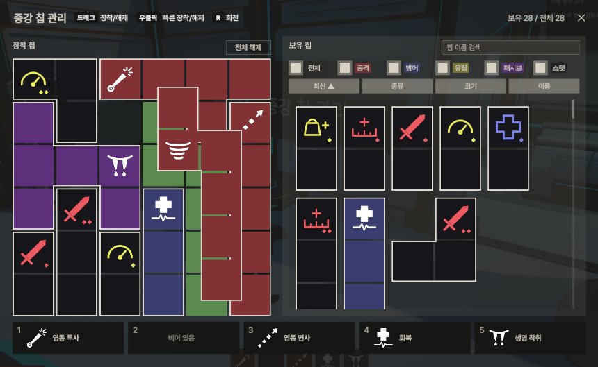

**핵심 플레이 루프**

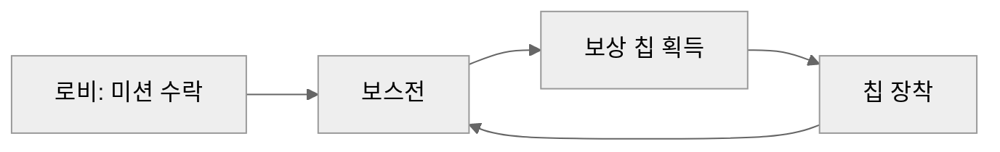

| 보스 | 난이도 | 유형 |
|---|---|---|
| 차르차로사우루스 | 이지 | 괴수형 |
| 페르데로스 | 노멀 | 괴수형 |
| 휴머노이드 | 하드 | 인간형, 2페이즈 |

| 이지 | 노멀 | 하드 |
|:---:|:---:|:---:|
| 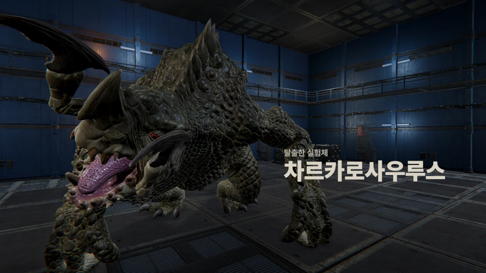 | 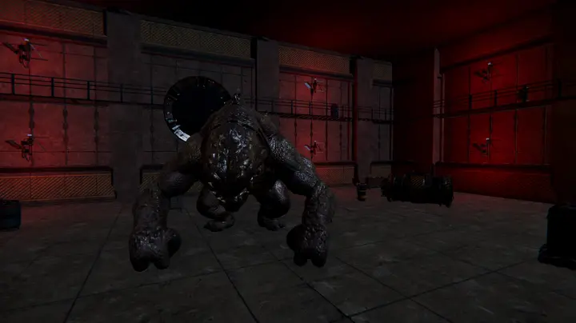 | 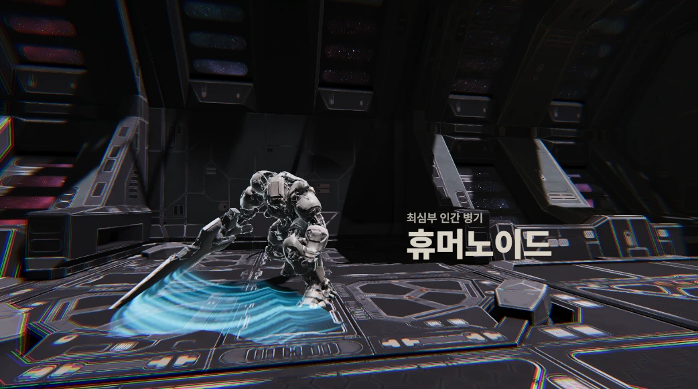 |

**조작법**

| 조작 | 키 |
|---|---|
| 이동 / 달리기 | WASD / Shift 길게 |
| 회피 | Space |
| 상호작용 | F |
| 염동력: 물체 들기 / 던지기 | 우클릭 길게 / 든 상태에서 좌클릭 |
| 스킬 | 숫자키 1~5 |
| 칩 회전 | 칩을 든 상태에서 R |

### 1.3 왜 만들었나

보스를 관찰하고, 염동력과 스킬로 스스로 공격 기회를 만들어 **자신만의 방식으로 보스를 공략하는 경험**을 주고 싶었습니다.

그러려면 보스가 한 공격만 노리고 쫓아다니지 않고, 플레이어의 위치와 거리에 맞춰 공격을 골라야 했습니다. 보스는 기본적으로 제가 맡았지만, 작업에 여유가 생긴 팀원이 새 보스를 더할 수도 있도록 보스 AI 기반은 패턴을 쉽게 추가할 수 있는 구조를 가장 먼저 목표로 삼았습니다(4.1).

### 1.4 이 문서가 다루는 것

이 문서는 세 보스가 함께 쓰는 **보스 AI 기반**과 그 위에 만든 **휴머노이드 보스**, 팀 전체의 피해를 처리하는 **전투 이벤트 기반**을 만들며 제가 부딪힌 문제와 그 해결 과정을 다룹니다.

| 장 | 내용 |
|---|---|
| 2~3 | 팀 구성과 내 역할, 전체 구조에서 제 파트의 위치 |
| 4~5 | 제 파트가 풀어야 했던 문제와 구조 |
| 6 | 핵심 기능: 전투 이벤트 큐, 의도 기반 판단, 패턴 구조, Kinematic 이동, 휴머노이드 보스, 효과음 |
| 7 | 다른 파트와 맞물릴 때 세운 원칙, 설계 의도를 전달한 방식과 그 결과 |
| 8 | 트러블슈팅 5건 (미해결 1건 포함) |
| 9 | 플레이 피드백과 회고 |

---

## 2. 팀 구성과 내 역할

### 2.1 역할 분담

| 담당 | 맡은 일 |
|---|---|
| 나 (팀장) | 보스 AI 기반, 휴머노이드 보스, 전투 이벤트 기반, 효과음 |
| 팀원 A | UI, 염동력, 시간 정지, 보스 연출(타격 판정·예고 표시·그로기·사망·인트로) |
| 팀원 B | 증강칩·스킬 |
| 팀원 C | 플레이어 이동, 미션·로비 |

### 2.2 내가 작성한 범위

| 영역 | 내용 |
|---|---|
| 전투 이벤트 기반 | 피해·회복 이벤트 큐, 전투 이벤트와 피해 정보, 전투 개체의 뼈대 |
| 보스 AI 기반 | 공용 상태 기계, 보스 판단(의도 기반)과 추격·회전·도약 상태, 근접 패턴 기반, 돌진·점프 내려찍기 패턴, Kinematic 이동, 경로 계산 |
| 휴머노이드 보스 | 상태와 패턴, 2페이즈, 투사체 반응, 분신, 차원 베기, 검 궤적, 큐브 낙하 |
| 효과음 | 사운드 매니저와 애니메이션 기반 효과음 |

---

## 3. 전체 구조와 파트 간 연결

### 3.1 전체 구조

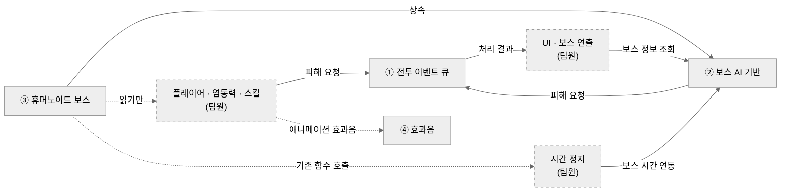

피해는 누가 만들든 ① 전투 이벤트 큐를 거치고, 세 보스는 모두 ② 보스 AI 기반 위에서 움직입니다.

| 번호 | 구성요소 | 책임 |
|---|---|---|
| ① | 전투 이벤트 큐 | 피해·회복 요청을 모아 매 프레임 처리하고 결과를 알림. 피해량 계산은 하지 않음 |
| ② | 보스 AI 기반 | 상태 기계, 의도 기반 판단, 근접 패턴 기반, 이동과 경로 계산 |
| ③ | 휴머노이드 보스 | ②를 상속해 만든 하드 난이도 보스 |
| ④ | 효과음 | 애니메이션 상태·컴포넌트·코드에서 쓰는 효과음과 BGM |

### 3.2 파트 간 연결 지점

| 내 쪽 | 상대 파트 | 연결 방식 |
|---|---|---|
| `CombatManager.AddCombatEvent` | 보스 타격 판정, 스킬, 염동력 | 공격하는 쪽이 피해 이벤트를 큐에 넣음 |
| `CombatManager.OnDamageEventExecuted` | HUD, 보스 피격 연출·그로기, 염동력 등 | 처리 결과를 이벤트로 받음. 큐는 받는 쪽을 모름 |
| `CombatEntity` | 보호막·무적·가드, 사망 처리 | 피해를 받는 `TakeDamage` 안에 분기로 추가됨 |
| `BossStateBase`, `BossMeleePattern` | 그로기·사망 상태, 타격 판정 | 그로기·사망은 상태 기반을 상속한 상태로, 타격 판정은 패턴 기반의 함수로 추가됨 |
| `HumanoidProjectileWatcher` | 염동력 | 날아오는 물체 목록과 상태를 **읽기만** 함 (7.1) |
| `HumanoidDimensionSlash` | 시간 정지·슬로모션·플레이어 제어 | 이미 있는 공개 함수만 호출 (7.1) |
| `AnimStateSoundSender` | 각 팀원의 애니메이션 | 애니메이션 상태에 붙이면 정해진 순간에 효과음이 재생됨 |

---

## 4. 담당 파트 개요

### 4.1 설계 목표

| 순위 | 목표 |
|---|---|
| 1 | 나중에 다른 팀원도 쉽게 패턴과 보스를 추가할 수 있는 구조 |
| 2 | 상황에 따라 유연하게 판단하는 보스 |
| 3 | 패턴 다양성 |
| 4 | 자연스러운 동작 |

### 4.2 풀어야 했던 문제

| 문제 | 상황 | 다루는 절 |
|---|---|---|
| 피해 처리를 누가 언제 부를지 모름 | 피해를 주는 기능(염동력·스킬·보스 패턴)이 여러 사람의 코드에 흩어져 있음 | 6.1 |
| 쫓기만 하는 보스 | 사거리 밖의 공격을 예약해 두고 추격하는 구조라, 보스가 계속 쫓아다니기만 함 | 6.2 |
| 패턴을 쉽게 추가하는 구조 | 보스는 한 사람이 맡지만, 여유가 생긴 팀원도 같은 기반 위에 새 보스를 추가할 수 있어야 함 | 6.3 |
| 투사체를 자연스럽게 밀어내지 못하는 이동 | 물리 기반 이동이라 투사체 무게에 따라 밀어내지 못하거나 어색함 | 6.4 |
| 같은 기반으로 다른 유형의 보스 | 괴수형용으로 만든 기반을 인간형 보스에 써야 함 | 6.5 |

---

## 5. 담당 파트 시스템 구조

### 5.1 클래스 구조

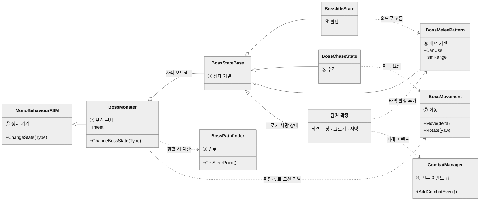

판단은 ④ 한 곳에서, 실제 움직임은 ⑦ 한 곳에서 일어납니다. 상태와 패턴은 "무엇을 할지"와 "얼마나 움직일지"만 정하고, 위치를 직접 바꾸지 않습니다.

| 번호 | 클래스 | 맡는 일 | 다른 곳에 맡긴 일 |
|---|---|---|---|
| ① | `MonoBehaviourFSM` | 자식 오브젝트의 상태를 타입으로 등록하고, 현재 상태를 끄고 다음 상태를 켜서 전환 | 보스 전용 처리 (→ ②) |
| ② | `BossMonster` | 대상까지 거리·각도·시야 계산, 지금 노리는 패턴(의도) 보관 | 패턴 선택 (→ ④) |
| ④ | `BossIdleState` | 후보 패턴을 모아 의도를 고르고, 공격·회전·추격 중 하나로 넘김 | 거리·방향 맞추기 (→ ⑤) |
| ⑤ | `BossChaseState`, `BossTurnState`, `BossHopState` | 다가가기·돌기·도약으로 거리와 방향을 맞추고 판단으로 돌아감 | 공격 선택 (→ ④) |
| ⑥ | `BossMeleePattern` | 공격 하나를 실행하고, 판단 상태에 사용 가능 여부(거리·각도·쿨다운)를 알려 줌 | 다른 패턴과의 비교 (→ ④) |
| ⑦ | `BossMovement` | 모든 이동·회전 요청을 모아 물리 스텝에서 적용, 벽에 막히면 벽면을 따라 미끄러짐 | 경로 계산 (→ ⑧) |
| ⑧ | `BossPathfinder` | NavMesh로 경로만 계산해 지금 향할 점을 제공 | 위치 이동 (→ ⑦) |
| ⑨ | `CombatManager` | 피해·회복 이벤트를 모아 매 프레임 처리, 결과를 이벤트로 알림 | 피해량 계산 (→ 받는 쪽 `TakeDamage`) |

### 5.2 상태를 자식 오브젝트로 둔 이유

상태는 보스의 자식 게임오브젝트이고, 전환은 이전 상태를 끄고 다음 상태를 켜는 것입니다. 진입·종료는 `OnEnable`·`OnDisable`이 맡습니다.

상태를 일반 C# 클래스로 만드는 방법도 생각했지만, 이 코드는 혼자 쓰는 코드가 아니었습니다. 상태 하나를 오브젝트 하나에 맡기면 팀원이 상태를 추가하거나 고칠 때 서로의 작업과 충돌할 일이 적다고 판단해 이 방식을 골랐습니다.

| | 일반 C# 클래스 상태 | 자식 오브젝트 상태 (선택) |
|---|---|---|
| 상태 추가 | 클래스를 만들고 상태 기계에 코드로 등록 | 상태 컴포넌트를 붙인 자식 오브젝트를 추가하면 타입으로 등록됨 |
| 상태별 설정값 | 코드나 별도 데이터(ScriptableObject 등)로 넘겨야 함 | 컴포넌트라 인스펙터에서 바로 설정 (6.3의 패턴 값) |
| 상태 확인 | 하이어라키에 드러나지 않아 로그나 디버거로 확인 | 하이어라키에서 켜진 오브젝트로 바로 확인. 패턴 오브젝트를 직접 켜고 끄며 테스트 가능 |
| 협업 | 상태 등록 코드가 한곳에 모여, 여러 사람이 고치면 작업이 겹치기 쉬움 | 상태 하나가 오브젝트 하나라 작업이 겹칠 일이 적음 |
| 비용 | 오브젝트를 만들지 않아 가벼움 | 상태 수만큼 오브젝트가 생겨 하이어라키가 길어짐 |

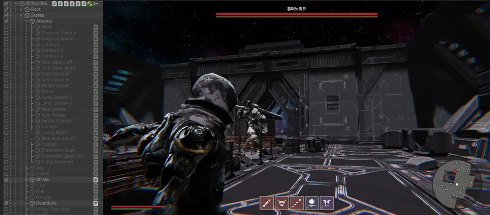

---

## 6. 핵심 기능

### 6.1 전투 이벤트 큐

| 항목 | 내용 |
|---|---|
| 목적 | 여러 곳에서 생기는 피해·회복을 같은 경로, 같은 시점에 처리 |
| 방식 | 진입점을 `AddCombatEvent` 하나로 두고, 요청을 큐에 모았다가 매 프레임 한 지점에서 처리한 뒤 결과를 이벤트로 알림 |
| 결과 | 피해·회복을 만드는 11개 파일이 모두 큐를 거침. 결과에 반응해 생기는 연쇄 처리(흡혈 회복 등)도 중첩 호출되지 않음 |

#### 동작 방식

피해를 주는 기능(염동력, 스킬, 보스 패턴)은 여러 사람의 코드에 흩어져 있고, 각자 필요한 때에 피해를 요청합니다. 이 요청은 모두 `AddCombatEvent`로 들어와 큐에 쌓이고, 매 프레임 한 지점에서 들어온 순서대로 처리됩니다.

보내는 쪽은 이렇게 부릅니다.

```csharp
CombatManager.Instance.AddCombatEvent(new DamageEvent(sender, receiver, info));
```

| 넣는 것 | 나오는 것 |
|---|---|
| `DamageEvent(보낸 쪽, 받는 쪽, 피해 정보)` | 받는 쪽의 `TakeDamage`가 호출되고, 받은 피해량이 `OnDamageEventExecuted`로 발행됨 |
| `HealEvent(보낸 쪽, 받는 쪽, 회복량)` | 받는 쪽의 `TakeHeal`이 호출되고, 받은 회복량이 `OnHealEventExecuted`로 발행됨 |

`DamageInfo`는 피해 한 건의 내용을 담는 구조체입니다. 피해량, 맞은 지점, 맞은 콜라이더는 반드시 넣고, 반응·그로기·밀어내기 같은 항목은 필요할 때만 넣습니다. 넣지 않은 항목은 기본값으로 처리됩니다.

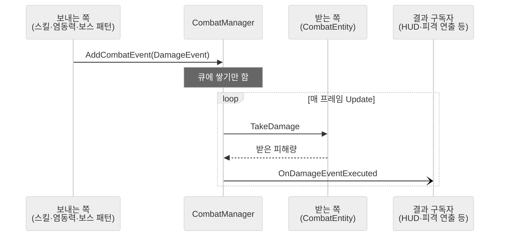

`CombatManager`는 누가 피해를 보냈는지, 누가 결과를 쓰는지 알지 못합니다. 그래서 피해를 주는 기능을 새로 만들어도 `CombatManager`는 고칠 필요가 없고, HUD처럼 결과가 필요한 쪽은 `OnDamageEventExecuted`를 구독하기만 하면 됩니다.

#### 처리 코드

```csharp
private readonly Queue<CombatEvent> eventQueue = new();

private void Update()
{
    int eventCount = eventQueue.Count;

    for (int i = 0; i < eventCount; i++)
        ExecuteEvent();
}

private void ExecuteEvent()
{
    CombatEvent combatEvent = eventQueue.Dequeue();

    // 받는 쪽 오브젝트가 이미 사라졌으면 처리하지 않음
    if (combatEvent.Receiver.GameObject == null) return;

    switch (combatEvent.Type)
    {
        case CombatEvent.EventType.Damage:
            ExecuteDamageEvent();
            break;
        case CombatEvent.EventType.Heal:
            ExecuteHealEvent();
            break;
        default:
            throw new NotImplementedException($"{combatEvent.Type} event is not implemented.");
    }

    void ExecuteDamageEvent()
    {
        DamageEvent damageEvent = combatEvent as DamageEvent;
        int receivedDmg = combatEvent.Receiver.TakeDamage(damageEvent);
        OnDamageEventExecuted?.Invoke(damageEvent, receivedDmg);
    }

    // ExecuteHealEvent도 같은 구조
}

public void AddCombatEvent(CombatEvent combatEvent) => eventQueue.Enqueue(combatEvent);
```

- 처리를 시작할 때 큐 개수를 한 번 읽고 그만큼만 꺼냅니다. 처리 도중 새로 들어온 요청(피해 결과에 반응한 흡혈 회복 등)은 다음 프레임으로 넘어갑니다.
- `CombatManager`에는 피해량 계산이나 체력 변경 코드가 없습니다. 계산은 받는 쪽 `TakeDamage`가 합니다.

#### 설계 선택: 직접 호출이 아니라 큐인 이유

피해가 같은 경로를 지나게 하는 것만이 목적이라면 진입 함수 하나를 직접 부르게 해도 됩니다. 두 방식의 차이는 처리 시점에서 생깁니다.

| | 진입 함수를 직접 호출 | 큐에 모아 매 프레임 처리 (선택) |
|---|---|---|
| 같은 경로 | 진입 함수 하나면 보장 | 보장 |
| 처리 시점 | 호출한 순간, 호출한 코드 한가운데 | `CombatManager.Update` 한 지점 |
| 연쇄 처리 | 결과에 반응한 처리(흡혈 회복 등)가 피해 처리 도중에 중첩 호출됨 | 처리 중 들어온 요청은 다음 프레임으로 넘어가 중첩되지 않음 |
| 결과 받기 | 반환값으로 바로 받음 | 결과 이벤트를 구독해 받아야 함 |
| 지연 | 없음 | 호출 시점에 따라 최대 1프레임. 이 때문에 생긴 문제는 없었음 (개선 계획은 9.2) |

정리하면, 처리 시점을 한 곳으로 정해 연쇄 처리가 끼어들지 않게 한 대신, 공격하는 쪽이 결과를 바로 받지 못하게 됐습니다. 실제 피해량은 받는 쪽이 무적·보호막 등을 반영해 정하는 값이라 어차피 처리 뒤에야 알 수 있고, 공격하는 쪽이 그 값으로 하는 일도 적중 효과나 패시브 발동 같은 후속 반응뿐이어서 감수할 수 있었습니다.

### 6.2 의도(Intent) 기반 보스 판단

| 항목 | 내용 |
|---|---|
| 목적 | 보스가 한 공격만 노리고 쫓아다니지 않고, 상황에 맞는 공격을 사용 |
| 방식 | 공격을 미리 예약하지 않고, 판단할 때마다 거리·방향에 맞는 공격을 다시 고름 |
| 결과 | 추격 중에도 1초마다 다시 골라, 거리가 바뀌면 쓰는 공격도 변경 |

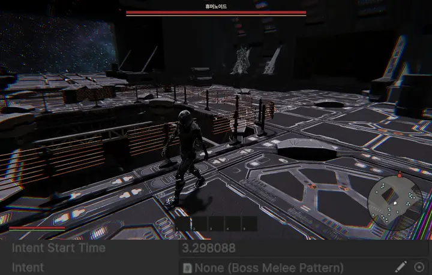

#### 동작 방식

**의도(Intent)** 는 보스가 지금 쓰려고 고른 공격입니다. 보스는 판단 상태에서 의도를 고르고, 거리와 방향이 맞으면 공격합니다. 맞지 않으면 회전이나 추격으로 맞춘 뒤 다시 판단 상태로 돌아옵니다.

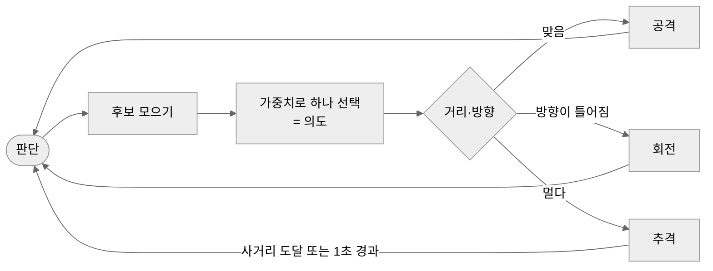

회전과 추격은 끝나도 곧바로 공격하지 않고 판단으로 돌아옵니다. 추격 중에도 1초마다 돌아오기 때문에, 그 사이 거리가 바뀌면 고르는 공격도 바뀝니다.

```csharp
// 추격을 멈추고 판단 상태로 돌아갈 조건
private bool ShouldStopChase()
{
    BossMeleePattern intent = root.Intent;

    if (root.CanKeepMovingToTarget == false) return true;            // 방향이 크게 틀어짐
    if (Clock.LocalTime - enterTime >= rethinkInterval) return true;  // 기본 1초마다 다시 판단

    // 고를 패턴이 없어 가려진 대상을 찾아가는 중이면 보이는 순간 다시 판단
    if (intent == null) return root.HasLineOfSight;

    return intent.IsDistanceInRange;                                   // 의도한 공격의 사거리에 들어옴
}
```

#### 후보를 고르는 규칙

```csharp
foreach (BossMeleePattern melee in melees)
{
    if (melee.CanUse == false) continue;
    if (melee.IsTooClose) continue;
    if (hasUrgent && melee.IsUrgent == false) continue;

    // 긴급 패턴이 하나라도 나오면 일반 후보는 비우고, 이후로는 긴급 패턴만 모음
    if (melee.IsUrgent && hasUrgent == false)
    {
        hasUrgent = true;
        hasInRange = false;
        candidates.Clear();
    }

    bool inRange = melee.IsInRange;

    // 사거리 안 패턴이 하나라도 나오면 사거리 밖 후보는 비우고, 이후로는 사거리 안 패턴만 모음
    if (hasInRange && inRange == false) continue;
    if (inRange && hasInRange == false)
    {
        hasInRange = true;
        candidates.Clear();
    }

    candidates.Add(melee);
}
```

- 후보는 **긴급 > 사거리 안 > 사거리 밖** 순으로 좁힙니다. 더 높은 등급이 하나라도 있으면 그 등급만 남깁니다.
- 긴급 패턴은 조건이 되면 반드시 써야 하는 공격입니다. 휴머노이드 보스가 체력이 일정 비율 아래로 내려가면 쓰는 차원 베기가 그 예입니다 (6.5).
- 남은 후보 중 하나는 패턴마다 정한 가중치로 고릅니다. 피하기 어렵거나 피해가 큰 공격이 일반 공격보다 덜 나오게 하기 위해서입니다.
- 고를 후보가 없을 때, 플레이어가 장애물 뒤에 있으면 돌아서 찾아가고, 방향이 틀어져 있으면 플레이어 쪽으로 돕니다.

#### 예시: 플레이어가 사거리 밖으로 물러난 경우

| 순서 | 상황 | 보스의 처리 |
|---|---|---|
| 1 | 플레이어가 뒤로 크게 물러남 | 사거리 안 공격이 없으므로 다가가야 닿는 공격들이 후보가 되고, 그중 하나가 의도가 됨 |
| 2 | 의도한 공격이 닿지 않음 | 추격 |
| 3 | 추격 1초 경과 | 판단으로 돌아와 후보를 다시 모음 |
| 4 | 그 사이 플레이어가 다시 다가와 있음 | 사거리 안 공격이 후보에 생겨 그 공격이 먼저 선택됨 |

#### 설계 변경: 예약에서 의도로

처음에는 보스가 공격부터 정했습니다. 사거리 밖이면 그 공격을 **예약**해 두고 추격으로 넘어갔다가, 사거리에 들어오면 예약한 공격을 썼습니다. 이 구조에서는 보스가 예약한 공격 하나를 쓰려고 플레이어를 계속 쫓기만 하는 단조로운 상황이 나왔습니다.

위 예시를 예약 구조로 처리하면, 1번에서 정한 공격에 보스가 묶여 4번에서도 그 공격의 사거리에 맞을 때까지 쫓기만 합니다. 그래서 공격을 미리 걸어 두지 않고, 판단할 때마다 다시 고르는 구조로 바꿨습니다.

| | 예약 (이전) | 의도 (현재) |
|---|---|---|
| 공격을 정하는 때 | 공격 상태에 들어가면서 한 번 | 판단할 때마다 |
| 사거리 밖이면 | 예약해 두고, 사거리에 들어올 때까지 쫓음 | 쫓다가 1초마다 돌아와 다시 고름 |

### 6.3 패턴 구조

| 항목 | 내용 |
|---|---|
| 목적 | 기반을 만든 사람이 아니어도 패턴과 보스를 쉽게 추가할 수 있는 구조 |
| 방식 | 패턴 사이의 차이는 인스펙터 값이 맡고, 상태는 타입으로 찾음 |
| 결과 | 다른 팀원이 프리팹 조립과 인스펙터 값만으로 보스 하나를 만듦 |

| 패턴 인스펙터 (`HumanoidDiagonalSlashA`) | 애니메이션 트리거 드롭다운 |
|:---:|:---:|
| 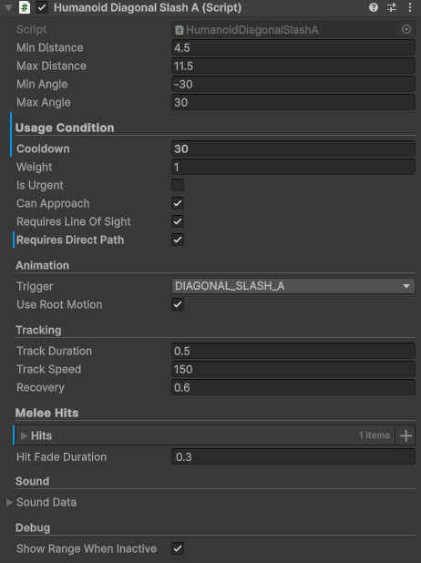 | 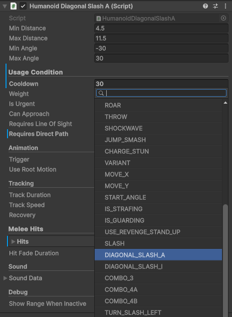 |

#### 동작 방식

패턴 하나를 추가하는 순서는 다음과 같습니다.

| 순서 | 할 일 |
|---|---|
| 1 | `BossMeleePattern`을 상속한 클래스를 만듦 |
| 2 | 보스의 자식 오브젝트에 붙이고, 인스펙터에서 사거리·각도·쿨다운·가중치·애니메이션 트리거·후딜을 정함 |
| 3 | 판단 상태(`BossIdleState`)의 패턴 목록에 등록 |

```csharp
public class BossSmash : BossMeleePattern { }
```

괴수형 보스의 근접 패턴 12개가 이렇게 이름만 있는 클래스입니다. 제가 만든 패턴 중 코드가 들어 있는 것은 돌진·점프 내려찍기·측면 회전 공격처럼 여러 단계로 이어지거나 움직임을 직접 계산하는 것들입니다.

패턴마다 다른 값은 모두 부모 클래스의 인스펙터 필드로 둡니다. 판단 상태는 이 값으로 만든 조건만 묻고, 패턴끼리는 서로를 비교하지 않습니다.

```csharp
[field: SerializeField] public float MinDistance { get; private set; }
[field: SerializeField] public float MaxDistance { get; private set; }
[SerializeField] private float minAngle;
[SerializeField] private float maxAngle;
[SerializeField] private float cooldown;
[field: SerializeField] public float Weight { get; private set; }
[field: SerializeField] public bool IsUrgent { get; private set; }   // 긴급 패턴 여부 (6.2)
[SerializeField, ValueDropdown("GetTriggers")] private int trigger;   // 애니메이션 트리거를 드롭다운으로 고름

// 판단 상태가 묻는 조건
public virtual bool CanUse => Clock.LocalTime >= readyTime && IsSightClear;
public bool IsInRange => IsDistanceInRange && IsAngleInside(root.SignedAngleToTarget);

// 특별한 동작이 필요한 패턴만 재정의
protected virtual void OnPatternEnter() { }
protected virtual void OnPatternExit() { }
```

- 애니메이션 트리거는 `BossAnimParams`에 모아 둔 애니메이터 파라미터 목록에서 드롭다운으로 고릅니다.
- 돌진처럼 단계가 있는 패턴만 진입·종료 함수를 재정의합니다.

#### 설계 선택: 상태를 무엇으로 찾을 것인가

상태 기계는 상태를 **타입**으로 등록하고 찾습니다. 그래서 패턴마다 서로 다른 타입이 필요했고, 본문 없는 클래스가 패턴 수만큼 생겼습니다.

| | Enum 키로 찾기 | 타입으로 찾기 (선택) |
|---|---|---|
| 상태를 바꾸는 코드 | 패턴을 추가할 때마다 Enum 항목을 늘려 상태와 연결해야 함 | `typeof(BossIdleState)`, `intent.GetType()`만으로 바꿈 |
| 클래스 수 | 키만 다르게 주면 같은 클래스를 여러 상태로 둘 수 있음 | 상태마다 클래스가 하나씩 생김 |

Enum 키도 고려했지만, 별도 키 없이 코드에서 `typeof`나 `GetType`으로 간단히 상태를 바꿀 수 있는 편의성을 골랐습니다. 상태마다 클래스가 하나씩 생기는 것은 트레이드오프로 두었습니다.

이 대가는 실제로 한 번 드러났습니다. 휴머노이드 보스의 차원 베기를 체력 66%와 33%에서 두 번 쓰려 했는데, 같은 클래스를 두 패턴으로 넣을 수 없어 상속만 받은 빈 클래스 `HumanoidDimensionSlash_2`를 하나 더 두었습니다.

### 6.4 Kinematic 이동과 경로 계산

| 항목 | 내용 |
|---|---|
| 목적 | 투사체 무게에 영향받지 않으면서 루트 모션을 쓰는 보스 이동 |
| 방식 | Kinematic Rigidbody로 바꾸고, 루트 모션을 포함한 모든 이동을 `BossMovement`에서 적용. 길 찾기는 NavMeshAgent 대신 경로만 계산 |
| 결과 | 투사체 무게가 보스 이동에 영향을 주지 않고, 루트 모션을 그대로 사용 |

#### 동작 방식

보스를 움직이는 길은 둘입니다. 상태가 요청하는 이동(추격·회전)과 애니메이션의 루트 모션입니다. 둘 다 위치를 직접 바꾸지 않고 `BossMovement`에 이동량을 **요청만** 하며, `BossMovement`가 이를 모아 물리 스텝(`FixedUpdate`)에서 한 번에 적용합니다.

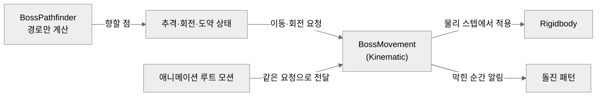

길 찾기(`BossPathfinder`)도 위치를 바꾸지 않고 "지금 향할 점"만 알려 줍니다.

```csharp
// 루트 모션도 이동 요청으로 넘김 (Animator가 transform에 바로 적용하면 벽을 통과함)
private void OnAnimatorMove()
{
    if (Animator.applyRootMotion == false) return;

    Movement.Move(Animator.deltaPosition);
    Movement.Rotate(Mathf.DeltaAngle(0f, Animator.deltaRotation.eulerAngles.y));
}

// 요청은 쌓기만 함
public void Move(Vector3 delta)
{
    delta.y = 0f;
    pendingDelta += delta;
}
public void Rotate(float deltaYaw) => pendingYaw += deltaYaw;

// 쌓인 요청은 물리 스텝에서 한 번에 적용
private void FixedUpdate()
{
    if (clock.IsFrozen) return;

    if (pendingYaw != 0f)
    {
        body.MoveRotation(Rotation);
        pendingYaw = 0f;
    }

    Vector3 delta = pendingDelta;
    pendingDelta = Vector3.zero;
    // ... 벽 판정(Sweep) 후 MovePosition
}
```

시간 정지 중(`clock.IsFrozen`)이면 적용을 건너뜁니다. 매 프레임 보스를 움직이는 곳이 여기 하나라, 시간 정지 중 이동을 멈추는 처리도 이 한 줄이면 됩니다.

보스는 향할 점이 정면 일정 각도 안에 있을 때만 걷고, 벗어나면 멈춰 서서 몸을 돌립니다. 처음에는 이 기준이 하나뿐이라, 걷는 도중 플레이어가 조금만 옆으로 움직여도 기준을 벗어났습니다. 그러면 멈추고, 돌고, 다시 걷는 동작이 반복되어 추격이 끊겨 보였습니다. 그래서 기준을 둘로 나눴습니다.

| 상황 | 걷는 기준 |
|---|---|
| 멈춰 있다가 걷기 시작할 때 | 향할 점이 정면 ±45° 안 |
| 이미 걷는 중일 때 | 정면 ±90° 안이면 멈추지 않고 걸으면서 방향을 고침 |

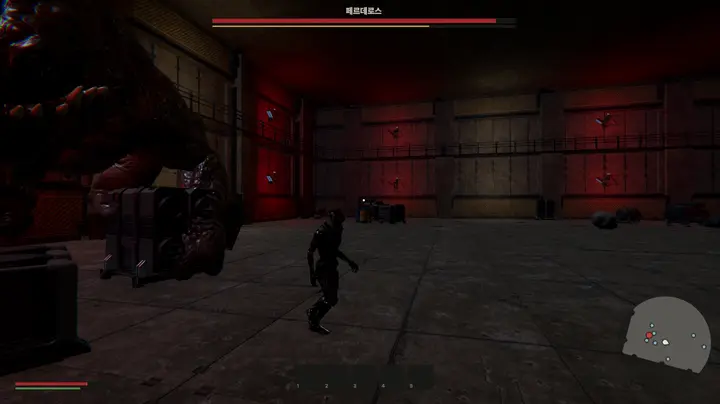

#### 예시: 플레이어가 벽 뒤로 숨은 경우

| 순서 | 상황 | 처리 |
|---|---|---|
| 1 | 보스와 플레이어 사이에 벽이 있음 | `BossPathfinder`가 NavMesh 경로의 꺾임점을 향할 점으로 줌 |
| 2 | 경로가 벽에 바짝 붙음 | 향할 점을 벽 반대쪽으로 밀어 줌 |
| 3 | 그래도 몸이 벽에 닿음 | 벽에 붙어 버티지 않고, 남은 이동량만큼 벽면을 따라 미끄러지며 계속 다가감(`Sweep`) |
| 4 | 돌진 중 벽에 정면으로 부딪힘 | `BossMovement`가 막힌 순간을 알림. 돌진 패턴은 벽 판정을 따로 하지 않고 이 알림으로 충돌을 판단 |

```csharp
// 막히면 벽 앞에서 멈추고, 남은 이동량은 벽면을 따라 미끄러지게 함
private Vector3 Sweep(Vector3 delta)
{
    float speed = delta.magnitude / Time.fixedDeltaTime;

    Vector3 remain = delta;
    Vector3 result = Vector3.zero;

    for (int i = 0; i < MAX_SLIDE_COUNT; i++)   // 최대 두 번 꺾음
    {
        float distance = remain.magnitude;
        if (distance <= 0.0001f) break;

        Vector3 dir = remain / distance;

        // 가는 방향에 벽이 없으면 남은 만큼 그대로 이동
        if (CastWall(body.position + result, dir, distance + SKIN_WIDTH, out RaycastHit hit) == false)
        {
            result += remain;
            break;
        }

        // 벽 바로 앞까지만 이동하고, 막힌 순간을 알림 (예시 4번)
        float movable = Mathf.Max(0f, hit.distance - SKIN_WIDTH);
        result += dir * movable;

        OnBlocked?.Invoke(new BossBlockInfo(hit, dir, speed));

        // 남은 이동량을 벽면 방향으로 꺾어 다시 시도 (예시 3번)
        remain = Vector3.ProjectOnPlane(remain - dir * movable, hit.normal);
        remain.y = 0f;
    }

    return result;
}
```

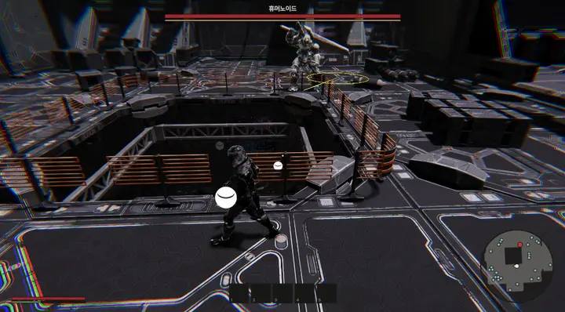

#### 설계 선택 ①: Dynamic인가 Kinematic인가

처음에 보스는 물리(Dynamic Rigidbody) 기반으로 움직였습니다. 그런데 플레이어가 염동력으로 던지는 투사체가 생기면서, 투사체 무게에 따라 보스가 투사체를 밀어내지 못하거나 밀어내도 어색한 문제가 생겼습니다.

| | Dynamic (이전) | Kinematic (선택) |
|---|---|---|
| 움직이는 주체 | 물리 엔진이 힘·속도로 움직임 | 코드가 준 이동량대로 움직임 |
| 투사체와의 관계 | 무게에 따라 밀어내지 못하거나 어색하게 밀어냄 | 무게의 영향을 받지 않음 |
| 직접 해야 하는 일 | — | 벽 충돌 처리 |

전환 직후에는 회전이 덜 되는 문제가 있었는데, 8.1에서 다룹니다.

#### 설계 선택 ②: NavMeshAgent에게 이동까지 맡길 것인가

길 찾기에는 먼저 `NavMeshAgent`를 실제로 붙여 봤습니다.

| | NavMeshAgent가 이동 | 경로만 계산, 이동은 `BossMovement` (선택) |
|---|---|---|
| 시간 정지 | Agent가 스스로 위치를 옮기므로 따로 멈추는 코드가 필요 | 이동을 적용하는 한 곳에서 건너뜀 |
| 루트 모션 | Agent와 루트 모션이 둘 다 위치를 옮겨 충돌하므로 하나를 포기해야 함. 함께 쓰려면 Agent의 위치 갱신을 끄고 직접 맞춰야 함 | 루트 모션을 그대로 씀 |
| 직접 해야 하는 일 | — | 경로 따라가기, 경로 재계산, 벽 가까이에서 밀어내기 |

루트 모션을 택한 이유는 움직임의 느낌입니다. 괴수형 보스가 90도 도는 동작을 코드로 회전시키면 제자리에서 미끄러지듯 돌아 보이지만, 루트 모션은 애니메이션에 담긴 움직임 그대로 돕니다. 이 움직임을 코드로 흉내 내는 것은 개발 기간에 비해 들일 만한 노력이 아니라고 판단했습니다.

그래서 Agent 없이 NavMesh로 경로만 계산하고, 그 경로를 따라가는 부분(예시의 1·2번)은 직접 만들었습니다.

### 6.5 휴머노이드 보스

| 항목 | 내용 |
|---|---|
| 목적 | 괴수형 보스용으로 만든 기반 위에 인간형 하드 보스를 추가 |
| 방식 | 공용 판단·추격 상태를 상속하고, 부모 타입으로 불러도 자식 상태로 연결. 페이즈 전환은 인터페이스로 알림 |
| 결과 | 공용 코드에 휴머노이드 전용 분기 없이 재사용 |

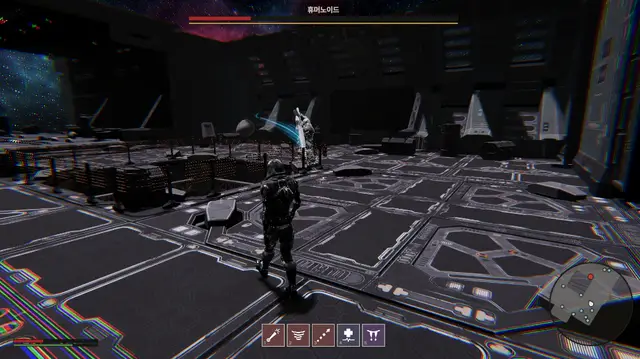

휴머노이드는 괴수형 보스에는 없는 세 가지를 가집니다. 체력이 줄면 패턴이 늘어나는 **2페이즈**, 플레이어가 던진 물체에 대응하는 **투사체 반응**, 세상을 멈추고 화면을 가르는 **차원 베기**입니다.

#### 기반 재사용: 부모 타입으로 불러도 자식 상태로

휴머노이드의 판단·추격 상태는 괴수형의 `BossIdleState`·`BossChaseState`를 상속한 `HumanoidIdleState`·`HumanoidChaseState`입니다. 그런데 공용 패턴 코드는 공격을 마치면 `typeof(BossIdleState)`로 돌아갑니다. 상태 기계는 실제 타입으로만 상태를 찾기 때문에, `BossIdleState`가 없는 휴머노이드에서는 돌아갈 상태를 찾지 못합니다.

타입으로 상태를 바꾸는 구조(6.3)를 유지하기 위해, 보스 본체가 시작할 때 부모 타입을 실제 자식 상태에 연결해 두었습니다.

```csharp
// 실제 타입을 먼저 다 넣고, 그 타입의 상태가 따로 없을 때만 부모 타입을 상속한 상태에 연결
private void MapStateTypes()
{
    BossStateBase[] states = GetComponentsInChildren<BossStateBase>(true);

    foreach (BossStateBase state in states)
        stateTypes[state.GetType()] = state.GetType();

    foreach (BossStateBase state in states)
    {
        for (Type type = state.GetType().BaseType; type != typeof(BossStateBase); type = type.BaseType)
            stateTypes.TryAdd(type, state.GetType());
    }
}

// 부모 타입으로 불러도 상속한 상태로 바꿔 넘김
public void ChangeBossState(Type nextState, bool ignoreReservedState = false)
{
    Type stateType = stateTypes.TryGetValue(nextState, out Type mapped) ? mapped : nextState;
    ChangeState(stateType, ignoreReservedState);
}
```

- 공용 패턴이 `typeof(BossIdleState)`를 부르면 휴머노이드에서는 `HumanoidIdleState`로 바뀌어 넘어갑니다.
- 괴수형 보스처럼 `BossIdleState`를 그대로 쓰는 보스는 실제 타입이 먼저 등록되어 있으므로 바뀌지 않고 그대로 동작합니다.

#### 2페이즈: 알릴 대상을 인터페이스로 찾기

체력이 기준 아래로 떨어지면, 컨트롤러가 보스 아래에서 `IHumanoidPhaseListener`를 구현한 컴포넌트를 모두 찾아 알립니다.

```csharp
// 전환 연출보다 먼저 알려야, 연출이 끝난 뒤 판단 상태가 2페이즈 패턴으로 고름
private void EnterPhase2()
{
    Phase = 2;
    boss.SetMotionSpeed(phase2MotionSpeed);

    foreach (IHumanoidPhaseListener listener in boss.GetComponentsInChildren<IHumanoidPhaseListener>(true))
        listener.EnterPhase2();

    boss.ChangeBossState(transition.GetType(), true);
}
```

| 알림을 받는 쪽 | 2페이즈에서 바뀌는 것 |
|---|---|
| 판단 상태 | 2페이즈 패턴(분신 소환 등)이 후보에 추가되고, 공격 사이 후딜이 짧아짐 |
| 투사체 반응 | 회피 위주에서 베어 내기·되던지기 위주로 가중치가 바뀜 |
| 그로기 상태 | 일어날 때 반격하는 동작이 확률로 나옴 |

이벤트 구독 대신 이렇게 한 것은, 전환 순간에 `GetComponentsInChildren`으로 쉽게 찾아 쓸 수 있기 때문입니다. 페이즈 전환은 한 판에 한 번뿐이라 이 정도 탐색 비용은 문제가 되지 않는다고 판단했고, 구독과 해제를 짝지어 관리할 필요도 없습니다.

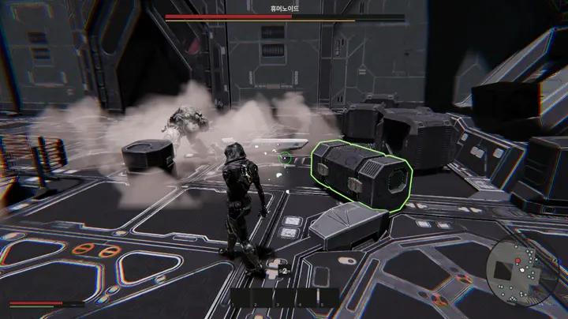

#### 투사체 반응

플레이어가 염동력으로 던진 물체가 날아오면, 휴머노이드는 맞기 전에 피하거나, 베어 내거나, 가드로 받아 되던지는 반응 중 하나를 가중치로 고릅니다. 보스는 염동력 쪽이 공개한 물체 목록과 상태를 읽어 날아오는 물체를 직접 감시합니다. 염동력 코드에 이벤트를 추가하는 대신 이 방식을 택한 것은, 팀원 코드를 최대한 건드리지 않기 위해서였습니다(7.1).

```csharp
// 날아오는 물체 중 가장 먼저 도착할 "맞을 물체"를 찾음 (발췌, 반응하지 않은 이유를 남기는 로그 처리는 생략)
private bool TryFindThreat(out PsychokinesisObject threat, out PsychokinesisObject rejected, out string rejectReason)
{
    // ...
    float soonest = float.MaxValue;
    Vector3 center = boss.transform.position + Vector3.up * centerHeight;

    // 염동력 쪽이 공개한 목록과 물체 상태를 읽기만 함
    foreach (PsychokinesisObject candidate in PsychokinesisObject.ActiveObjects)
    {
        if (candidate.IsHeld) continue;
        if (playerObjects.Contains(candidate) == false) continue;   // 플레이어가 들었던 물체만

        Rigidbody body = candidate.Body;
        if (body.isKinematic) continue;

        Vector3 velocity = body.linearVelocity;
        float speed = velocity.magnitude;
        // ... (멈춘 물체는 목록에서 지움)

        Vector3 offset = center - body.worldCenterOfMass;
        float distance = offset.magnitude;
        if (distance > detectRadius) continue;

        // 진행 방향으로 보스까지 남은 거리와 도착 시간
        float along = Vector3.Dot(offset, velocity / speed);
        if (along <= 0f) continue;                       // 멀어지는 중
        float arriveTime = along / speed;
        if (arriveTime > reactTime || arriveTime >= soonest) continue;

        // 진행선이 몸통 중심에서 비껴 지나가는 거리
        float miss = Mathf.Sqrt(Mathf.Max(0f, distance * distance - along * along));
        if (miss > hitRadius) continue;                  // (실제 코드는 거절 이유를 기록한 뒤 continue)
        if (IsInFront(body.worldCenterOfMass) == false) continue;   // 등 뒤에서 오는 물체는 무시

        soonest = arriveTime;
        threat = candidate;
    }

    return threat != null;
}
```

- 도착까지 남은 시간이 반응 시간 안이고, 진행선이 몸통 반경 안을 지나는 물체만 맞을 물체로 봅니다.
- 플레이어가 들었던 물체만 봅니다. 방 기믹으로 떨어지는 큐브나 다른 보스가 던진 물체에는 반응하지 않습니다.
- 등 뒤에서 오는 물체는 무시해, 뒤를 노리는 공략 여지를 남겼습니다.

| 회피 | 베어 내기 | 가드 후 되던지기 |
|:---:|:---:|:---:|
| 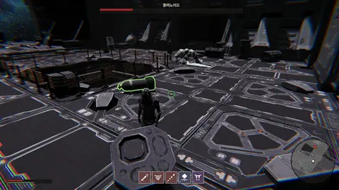 | 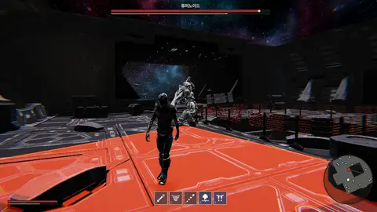 | 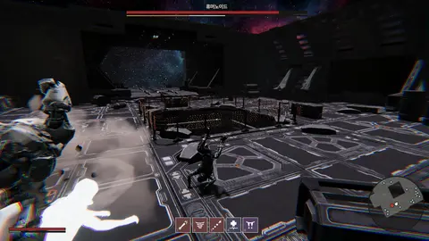 |

#### 차원 베기

체력이 일정 비율 아래가 되면 반드시 쓰는 긴급 패턴입니다(6.2). 세상을 멈추고, 플레이어 정면에 나타나 천천히 걸어와 검을 내려베며, 화면을 가르고 피해를 줍니다. 피할 수 없는 대신 일정 체력 아래로는 깎지 않습니다.

| 연출 | 쓴 기존 기능 |
|---|---|
| 세상 정지, 보스만 예외 | `TimeFreezable.FreezeWorld`, `SetWorldExempt` |
| 플레이어만 아주 느리게, 염동력·스킬 잠금 | `SlowMotion.AddPlayerOnly`, `PlayerController.SetSuperpowerLocked` |
| 회색·깨짐 화면 | `ScreenGlitch` |

필요한 기능은 시간 정지·플레이어 쪽 코드를 고치지 않고 이미 있는 함수를 불러 조합했습니다. 보스가 한순간도 느려지지 않도록 보스 예외를 먼저 걸고 세상을 멈추며, 풀 때는 반대 순서로 풉니다. 패턴이 중간에 끊겨도 종료 처리에서 세상·플레이어·화면을 모두 원래대로 되돌립니다.

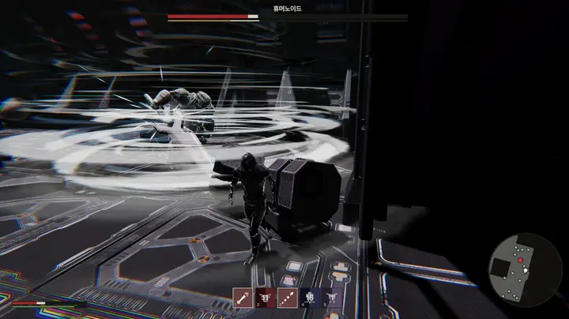

#### 그 밖의 구성

| 요소 | 내용 |
|---|---|
| 분신 소환 | 2페이즈에서 본체 체력의 일정 비율을 가진 분신을 좌우 한쪽에 부름. 소환 순간 끊기지 않도록 다음 분신을 처음부터 미리 복제해 꺼 둠 |
| 큐브 낙하 | 플레이어가 던질 물체를 공급하는 환경 |
| 검 궤적 | 칼날 밑동과 끝의 지난 위치로 면을 만듦. TrailRenderer로는 원하는 느낌이 나지 않아 직접 메시를 만듦 |

| 분신 소환 | 큐브 낙하 | 검 궤적 |
|:---:|:---:|:---:|
| 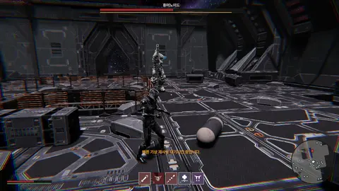 | 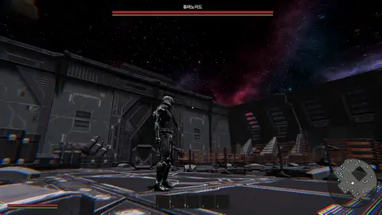 | 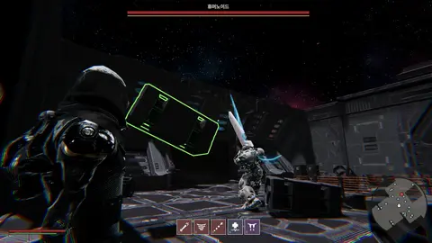 |

### 6.6 (보조) 애니메이션 기반 효과음

| 항목 | 내용 |
|---|---|
| 목적 | 공격 모션의 특정 순간에 효과음을 붙이는 방법을 팀에 제공 |
| 방식 | 애니메이션 상태에 "몇 % 지점에 어떤 소리"를 지정하면 `SoundManager`가 재생. 상황에 따라 고를 수 있게 재생 방식을 세 가지로 둠 |
| 결과 | 방식마다 사용 예시를 만들어 공유했고, 애니메이션 상태 방식은 팀원들이 가져다 씀 |

#### 강사님 제공 구조에서 바꾼 것

강사님이 제공한 `AnimStateEventSender`는 애니메이션 상태에 붙어 진행률을 보고 신호를 보내고, 오브젝트에 붙은 Listener가 신호 이름을 보고 처리하는 구조였습니다. 효과음을 빠르게 붙이기에 좋아 보여 이 구조를 참고해, 효과음 전용 `AnimStateSoundSender`를 만들었습니다.

| | 강사님 제공 구조 (`AnimStateEventSender`) | 효과음용 구조 (`AnimStateSoundSender`) |
|---|---|---|
| 상태에 적는 것 | 진행률, 신호 이름, 문자열 파라미터 | 진행률, 소리(클립을 드롭다운으로 고르고 볼륨 지정) |
| 신호를 받는 쪽 | 오브젝트에 붙인 Listener가 이름을 보고 처리 | Listener 없이 `SoundManager`로 바로 재생 |
| 반복 상태 (걷기 등) | 상태에 들어올 때만 보낸 기록을 지워, 반복하는 동안은 다시 나가지 않음 | 한 바퀴 돌 때마다 기록을 지워, 매 바퀴 다시 재생 |
| 상태가 중간에 끊기면 | 끝날 때 못 보낸 신호를 마저 보냄 (8.3에서 추가한 처리) | 남은 소리는 재생하지 않음. 끊긴 공격 뒤에 타격음이 나오지 않게 함 |

마지막 행은 두 구조가 반대로 동작합니다. 공격이 끝났다는 신호는 상태가 끊겨도 반드시 전달되어야 하지만(8.3), 효과음은 끊긴 동작의 소리가 뒤늦게 나오면 오히려 어색하기 때문입니다.

```csharp
// 강사님 제공 구조: 신호 이름과 파라미터를 Listener에 넘기면, 받은 쪽이 이름을 보고 처리
eventListener.OccursAnimStateEvent(eventData.Name, eventData.Parameter);
```

```csharp
// 효과음용 구조 (발췌, 되감기·전환 중·재생 간격 처리는 생략)
[Serializable]
public class AnimStateSound
{
    [SerializeField, Range(0f, 1f)] private float time = 0f;                   // 몇 % 지점에서
    [SerializeField, InlineProperty, HideLabel] private SoundData sound;      // 어떤 소리를
    public bool IsComplete { get; set; }
}

public override void OnStateUpdate(Animator animator, AnimatorStateInfo stateInfo, int layerIndex)
{
    float normalizedTime = stateInfo.normalizedTime;

    // 반복 상태는 한 바퀴 돌 때마다 재생 기록을 지워 다시 재생
    if (stateInfo.loop)
    {
        int loop = Mathf.FloorToInt(normalizedTime);
        if (loop != currLoop)
        {
            currLoop = loop;
            ResetSounds();
        }
        normalizedTime -= currLoop;
    }

    for (int i = 0; i < sounds.Length; i++)
    {
        AnimStateSound sound = sounds[i];
        if (sound.NormalizedTime > normalizedTime) continue;

        TryPlay(animator, sound, mute);   // 아직 안 낸 소리면 sound.Sound.Play()로 SoundManager에 요청
    }
}

// OnStateExit은 두지 않음: 상태가 끊기면 남은 소리는 재생하지 않음
```

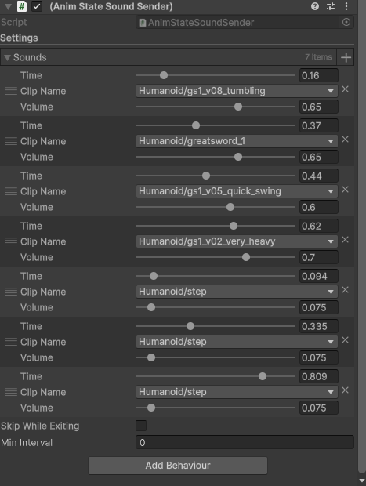

#### 재생 방식 세 가지

| 방식 | 쓰는 곳 | 사용법 |
|---|---|---|
| 애니메이션 상태 (`AnimStateSoundSender`) | 공격 모션의 특정 순간 | Animator 창에서 상태에 Behaviour로 추가하고, 진행률과 소리를 목록으로 지정 |
| 컴포넌트 (`SoundPlayer`) | UI 버튼 등 | 오브젝트에 붙여 소리를 고르고, 버튼 OnClick 같은 UnityEvent에 `Play`를 연결 |
| 코드 필드 (`SoundData`) | 코드로 제어하는 연출 | 클래스에 `SoundData` 필드를 선언해 인스펙터에서 소리를 고르고, 코드에서 `Play()` 호출 |

세 방식은 모두 `SoundData`를 거쳐 `SoundManager`가 재생합니다. `SoundData`는 인스펙터에서 클립을 목록으로 고를 수 있게 만들었습니다.

```csharp
// 컴포넌트 없이 쓰는 쪽 클래스에 필드로 선언해 두고, 인스펙터에서 클립과 볼륨을 골라 재생함
[Serializable]
public class SoundData
{
    [ValueDropdown("GetClipNames")]                       // 아래 함수가 만든 목록에서 고름
    [SerializeField] private string clipName;
    [SerializeField, Range(0f, 1f)] private float volume = 1f;

    public void Play()
    {
        if (Sound == null) return;   // 게임 종료 중에는 싱글톤이 null을 돌려줌
        Sound.Play(clipName, volume);
    }

#if UNITY_EDITOR
    // Resources/Audios 아래 클립을 찾아, 그 폴더 기준 경로(확장자 제외)로 목록을 만듦
    // 경로의 '/'로 드롭다운이 폴더별로 묶임
    private static IEnumerable<string> GetClipNames()
    {
        string[] guids = AssetDatabase.FindAssets("t:AudioClip", new[] { AUDIO_FOLDER });
        List<string> result = new();

        for (int i = 0; i < guids.Length; i++)
        {
            string path = AssetDatabase.GUIDToAssetPath(guids[i]);
            string relativePath = path.Substring(AUDIO_FOLDER.Length + 1);
            result.Add(Path.ChangeExtension(relativePath, null));
        }

        result.Sort(StringComparer.Ordinal);
        return result;
    }
#endif
}
```

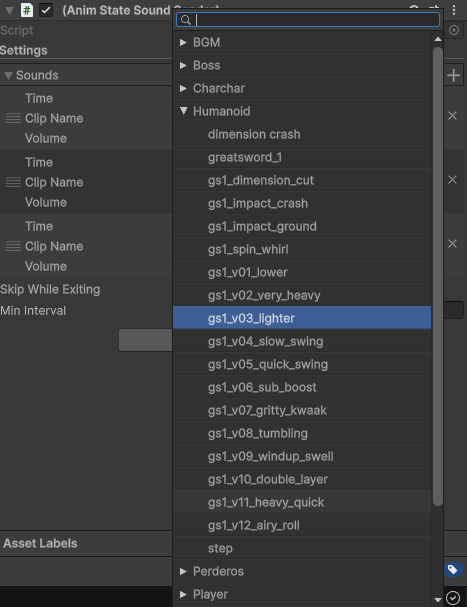

- Odin Inspector의 `ValueDropdown`이 에디터에서 `GetClipNames`를 불러 목록을 띄우므로, 클립 이름을 직접 입력하지 않습니다.
- 저장되는 값은 폴더 기준 경로라, 실행 중에는 `SoundManager`가 이 경로로 `Resources.Load`해 같은 클립을 찾습니다. 하위 폴더에 있는 클립도 같은 방식으로 찾을 수 있습니다.
- 사용하는 쪽은 `SoundData` 필드를 하나 선언하고 `Play()`만 부르면 됩니다.

---

## 7. 협업에서의 고민과 선택

### 7.1 남의 코드는 크게 고치지 않는다

| 항목 | 내용 |
|---|---|
| 상황 | 보스 기능이 다른 파트의 시스템(염동력, 시간 정지, 플레이어 제어)과 맞물려야 함 |
| 결정 | 다른 파트 코드는 약간의 수정이나 API 한두 개를 여는 정도까지만 고치고, 나머지는 보스 쪽에서 해결 |
| 결과 | 팀 원칙으로 세웠지만, 마감이 가까워질수록 지켜지지 않는 경우가 많아짐 |

필요한 부분을 상대 코드에서 직접 고칠지, 상대 코드는 그대로 두고 보스 쪽에서 해결할지 정해야 했습니다.

| | 필요하면 상대 코드를 직접 고침 | 상대 코드는 크게 고치지 않음 (선택) |
|---|---|---|
| 허용 범위 | 보스 기능에 맞게 구조까지 바꿈 | 약간의 수정이나 API 한두 개를 여는 정도까지만 |
| 보스 쪽에서 할 일 | 적음 | 공개된 함수와 값만으로 구현해야 함 |

상대 코드를 크게 건드리지 않기로 한 이유는 세 가지입니다.

1. 남의 코드에 함부로 손대는 것 자체가 감정적인 문제로 번질 수 있습니다.
2. 코드를 만든 사람의 설계 의도를 해칠 수 있습니다.
3. 포트폴리오를 위한 팀 프로젝트였기 때문에, 남의 코드를 제 의도대로 고쳐 버리면 그 코드를 만든 사람이 자기 몫을 온전히 챙겨 갈 수 없습니다.

대신 보스 쪽에서 돌아가는 방법을 써야 했습니다. 휴머노이드 보스의 투사체 반응은 염동력 코드에 이벤트를 추가하는 대신 날아오는 물체를 직접 감시하게 만들었고, 차원 베기는 시간 정지·슬로모션·플레이어 제어의 기존 함수만 불러 연출을 조합했습니다(6.5).

**개인 원칙에서 팀 원칙으로.** 처음에는 제 원칙이었습니다. 10월 말, 제가 만든 차원 베기 패턴이 저와 상의 없이 수정된 뒤 나중에 공유되는 일이 있었습니다. 저는 팀장으로서 위의 세 가지 이유를 설명하며 이것을 팀 원칙으로 세웠습니다.

**결과.** 원칙은 일부만 지켜졌습니다. 몇몇 작업은 팀원이 미리 말해 조율했지만, 마감에 가까워질수록 그렇지 않은 경우가 많아졌습니다.

### 7.2 설계 의도를 어떻게 전달할 것인가

기반을 만들고 그 위에 다른 사람이 기능을 얹는 구조였기 때문에, 사용법을 전달하는 방식이 결과에 직접 영향을 줬습니다.

| 기반 | 전달 방식 | 결과 |
|---|---|---|
| 애니메이션 기반 효과음 (6.6) | 방식마다 사용 예시를 만들어 공유 | 예시대로 쓰임 |
| 전투 이벤트 기반 (6.1) | 구조(의도)만 전달: "공격자가 `DamageInfo`에 담아 보내고, 피격자가 스스로 판단한다" | 피해는 모두 큐를 거쳤지만, 플레이어의 피격 판단 일부가 맞는 쪽이 아니라 공격하는 쪽 코드에 들어감 |

저는 전투 흐름만 만들었고, 구체적인 피해 계산과 전투 처리는 다른 팀원이 맡았습니다. 그래서 위의 구조(의도)만 전달했고, 보낼 정보가 늘어나면 담당자가 `DamageInfo`에 항목을 늘려 보낼 것이라고 생각했습니다.

하지만 개발이 진행되면서 피격 판단에 필요한 정보가 `DamageInfo`에 담기지 않은 채 처리되었고, 공격하는 쪽 코드가 맞는 쪽의 정보를 직접 알아야 하는 구조가 되었습니다. 이후 다른 팀원이 이를 발견해 피격 판단을 맞는 쪽으로 옮기는 리팩터링 방안을 냈고, 저는 팀장으로서 방안을 확인하고 승인해 진행하게 했습니다.

돌아보면 의도만 말할 것이 아니라 사용법을 더 자세히 알려 줬어야 했습니다.

---

## 8. 트러블슈팅

### 8.1 Kinematic으로 바꾼 뒤 보스가 아주 조금씩만 회전함

| | 내용 |
|---|---|
| 현상 | 이동을 Kinematic으로 바꾼 뒤(6.4), 보스가 몸을 돌리긴 하지만 확연히 적은 양만 회전 |
| 원인 찾기 | Rigidbody 관련 문제라는 것은 바로 알았지만 원인은 찾지 못함. AI에게 분석을 맡겨 Rigidbody의 Interpolate 설정이 원인임을 알게 됨 |
| 원인 | Interpolate가 켜진 Rigidbody는 보간된 값으로 transform을 덮어씀. 그래서 transform에 직접 준 회전이 보간값으로 되돌려짐 |
| 해결 | 이동·회전 요청을 쌓아 두고 `FixedUpdate`에서 `MovePosition`·`MoveRotation`으로 적용. `MoveRotation`은 물리 쪽 회전 상태를 갱신하므로 보간이 갱신된 값을 기준으로 진행됨 (코드는 6.4) |
| 배운 점 | Interpolate가 transform을 어떻게 다루는지 이 문제로 알게 됨 |

### 8.2 추격할 때 보스의 상체가 들림

| | 내용 |
|---|---|
| 현상 | 보스가 플레이어를 추격할 때 몸이 위를 보며 상체가 들림 |
| 원인 | `transform.LookAt`이 대상 위치를 향해 위아래(피치)까지 돌림 |
| 해결 | 수평면 기준 회전으로 바꾸고, 이후 `BossMovement.Rotate`가 수직축 각도 하나만 받도록 정리 |

### 8.3 애니메이션이 끝났는데 보스가 멈춰 있음

| | 내용 |
|---|---|
| 현상 | 공격 애니메이션이 끝나면 `OnAttackEnded` 신호로 판단 상태에 돌아가야 하는데, 신호가 오지 않아 패턴이 멈추는 경우가 있음 |
| 원인 | 신호는 애니메이션 진행률이 정해진 값을 지날 때 보내는 방식(강사님 제공 구조). 진행률이 정확히 1을 거치지 않고 다음 상태로 넘어가면, 1에 걸어 둔 종료 신호가 나가지 않음 |
| 해결 | 상태가 끝날 때 아직 못 보낸 신호를 마저 보냄. 이미 보낸 신호는 건너뜀 |
| 부작용 처리 | 휴머노이드의 투사체 반응은 공격 도중을 끊고 들어가므로, 끊긴 상태가 끝나며 몰아 보낸 종료 신호를 받아 바로 끝나 버릴 수 있음. 그래서 반응 패턴은 진입 후 0.2초 동안 신호를 무시. 상태 전환 시간(0.12초)보다 길고, 반응 패턴의 가장 이른 신호(약 0.28초)보다 짧은 값 |

강사님이 제공한 신호 구조에 제가 추가한 부분입니다.

```csharp
public override void OnStateExit(Animator animator, AnimatorStateInfo stateInfo, int layerIndex)
{
    // 상태가 끝날 때까지 못 보낸 신호(예: time = 1)를 마저 보냄
    for (int i = 0; i < events.Length; i++)
        TrySendEvent(events[i]);
}

private void TrySendEvent(AnimStateEvent eventData)
{
    if (eventData.IsComplete) return;   // 이미 보낸 신호는 건너뜀
    // ... (신호 전송은 원본 코드)
}
```

### 8.4 분신의 체력을 깎아 놨는데 다시 소환됨

| | 내용 |
|---|---|
| 현상 | 분신의 체력을 반쯤 깎아 놨는데, 차원 베기가 시작되면 분신이 사라지고 보스가 분신을 다시 소환 |
| 원인 | 시간 정지 연출 쪽 문제 때문에, 차원 베기에 들어가면 분신을 아예 제거하고 있었음 |
| 해결 | 분신을 제거하지 않고 꺼 두기만 하고, 차원 베기가 끝나면 체력을 유지한 채 다시 등장시킴 |

### 8.5 (미해결) 보스가 가끔 맵 밖으로 나감

| | 내용 |
|---|---|
| 현상 | 최종 빌드를 만들며 플레이 테스트하던 중, 보스가 아주 가끔 NavMesh 밖으로 나가 맵 밖을 걷는 문제를 발견. 주로 돌진 패턴에서 발생 |
| 추정 원인 | 두 가지를 의심. 하나는 터널링. 다른 하나는 NavMesh 경계 제한이 발밑 가까이에 NavMesh가 있을 때만 걸리기 때문에, 순간이동이나 루트 모션으로 한 번 크게 벗어나면 제한이 걸리지 않는다는 점. |
| 대응 | 남은 일정으로는 원인을 확정하고 고칠 시간이 부족해, NavMesh 밖에 일정 시간 넘게 머물면 가장 가까운 NavMesh 위로 되돌리는 방어 컴포넌트(`BossNavMeshGuard`)를 넣음 |
| 남은 일 | 9.2에서 다룸 |

---

## 9. 결과 및 배운 점

### 9.1 결과

| 문제 (4.2) | 결과 |
|---|---|
| 피해 처리를 누가 언제 부를지 모름 | 피해·회복을 만드는 11개 파일이 모두 전투 이벤트 큐를 거침 (6.1) |
| 쫓기만 하는 보스 | 추격 중에도 1초마다 후보를 다시 골라, 공격 하나를 위해 계속 쫓는 흐름이 끊김 (6.2) |
| 패턴을 쉽게 추가하는 구조 | 다른 팀원이 프리팹 조립과 인스펙터 값만으로 보스 하나를 만듦 (6.3) |
| 투사체를 자연스럽게 밀어내지 못하는 이동 | 투사체 무게가 보스 이동에 영향을 주지 않고, 루트 모션을 그대로 사용 (6.4) |
| 같은 기반으로 다른 유형의 보스 | 휴머노이드 보스가 공용 상태·패턴을 전용 분기 없이 상속해 재사용 (6.5) |

게임 전체로는 반 학우와 지인들의 플레이 피드백에서 UI·화면 전환·보스전 연출이 깔끔하다는 평, 조작이 부드럽다는 평, 프레임 드랍이 거의 없다는 평을 받았습니다. 연출과 조작은 팀원들의 작업이 함께 만든 결과입니다.

### 9.2 아쉬운 점과 개선 계획

플레이 피드백에서 받은 지적과 문서를 정리하며 다시 본 부분을 모아 개선 방향을 정리했습니다.

| 아쉬운 점 | 당시 판단 | 개선 계획 |
|---|---|---|
| **차원 베기가 "결과의 평등"을 만듦.** 피할 수 없이 발동하고, 잘하든 못하든 비슷한 비율로 체력을 깎는다는 피드백 | 원래는 기믹을 수행하면 파훼하는 패턴으로 만들고 싶었지만, 기간이 부족해 강제 진행 패턴으로 만들고 일정 체력 아래로는 깎지 않게 함 | 원래 목적대로 기믹 수행형 패턴으로 변경 |
| **분신과 본체 기술이 겹쳐 같이 맞음** | 분신이 본체와 같은 패턴을 그대로 가짐 | 분신의 패턴 수를 줄이고, 본체와 같은 기술을 동시에 쓰지 않도록 사용 조건을 조정 |
| **투사체 패링이 불합리하게 느껴짐** | 패링은 의도한 난이도 요소였고, 플레이테스트 의견으로 반응 확률을 0.5에서 0.3으로 이미 낮춤 | 반응 확률을 더 낮춤 |
| **보스들이 거리를 좁히는 기술이 너무 많음** | 보스가 쉬지 않고 플레이어와 싸우는 구도를 만들려고 거리를 좁히는 패턴을 많이 넣음. 이 게임의 플레이어가 기본적으로 중·원거리에서 싸운다는 점을 간과함 | 거리를 좁히는 패턴을 줄이고 원거리 기술을 추가해, 중·원거리에서 싸우는 플레이어에 맞는 패턴 구성으로 변경 |
| **보스가 가끔 맵 밖으로 나감** (8.5) | 막바지에 발견해 원인을 확정하지 못하고 되돌리는 방어 처리로 대응 | 이동 로직 자체에 NavMesh 위인지 검사하는 가드를 두거나, 터널링이 일어나지 않도록 맵을 수정 |
| **전투 이벤트가 최대 1프레임 늦게 처리됨** (6.1) | 큐를 `Update`에서 처리하고 실행 순서는 따로 정하지 않음. 지연 때문에 생긴 문제는 없었음 | 처리 시점을 `LateUpdate`로 옮겨, 애니메이션 신호로 들어오는 보스 타격까지 같은 프레임에 처리 |

### 9.3 협업에서 배운 점

**규칙은 처음에, 문서로.** 저는 작업 규칙과 브랜치 규칙, 폴더 규칙을 처음부터 명확히 공지하지 않고 시작했습니다. 그러자 각자의 방식대로 작업하면서 흐트러지는 부분이 생겼습니다. 다 쓴 브랜치가 정리되지 않거나, 외부 에셋이 최상위 폴더에 그대로 놓이는 식이었습니다. 다음 팀 프로젝트에서는 규칙을 문서로 정리해 처음부터 공유하겠습니다.

**의도가 아니라 사용법을 전달한다.** 예시를 만들어 공유한 효과음은 팀원들이 그대로 가져다 썼지만, 의도만 전달한 전투 구조는 처음에 의도대로 쓰이지 않았습니다(7.2). 기반을 만드는 사람으로서 사용법을 더 자세히 알려 줘야 한다는 것을 배웠습니다.
